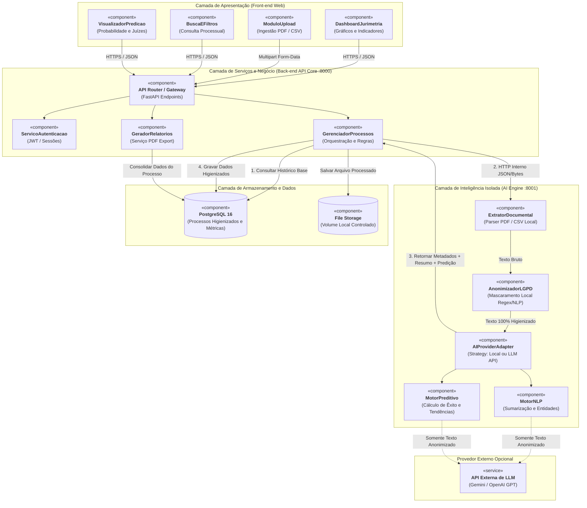
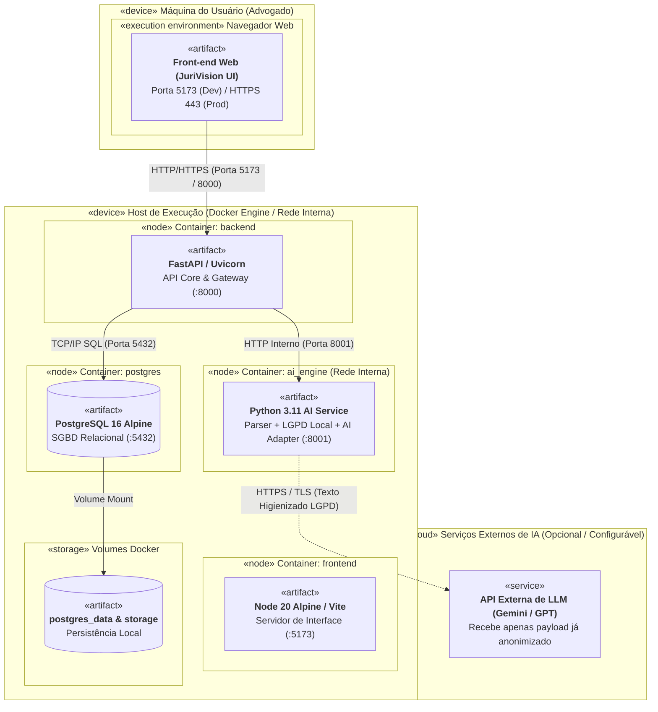
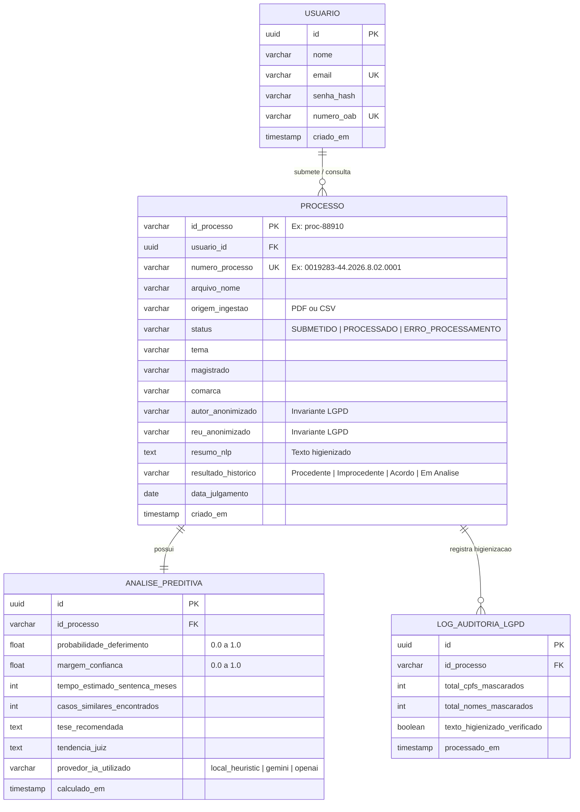

# Especificação Arquitetural e Técnica — JuriVision (Equipe Epsilon)

> **Projeto Avaliativo da Disciplina de Gerência de Projetos (Prof. Rafael De Amorim) — UFAL**  
> **Sistema:** JuriVision — Plataforma Analítica e Preditiva para Gestão de Processos Jurídicos  
> **Normas de Referência:** ISO/IEC/IEEE 42010 (Descrição Arquitetural), ISO/IEC 25010 (Qualidade de Produto), ISO/IEC 27001 e LGPD (Segurança e Privacidade)

---

## 1. Visão Geral do Produto e MVP

O **JuriVision** resolve a sobrecarga de análise processual manual de escritórios de advocacia através de:

1. **Ingestão Híbrida:** Upload de peças em PDF (fluxo principal) e importação em lote via planilhas CSV.
2. **Esteira de Dados Segura (LGPD):** Mascaramento obrigatório e local de dados pessoais (CPFs, RGs, nomes reais das partes) antes de qualquer persistência ou comunicação com serviços externos de IA.
3. **Extração e Sumarização (NLP Híbrido):** Leitura via OCR/Parser com geração de resumo factual do processo por meio de motor de IA desacoplado (suporte a API externa de LLM como Google Gemini / OpenAI GPT ou processamento local leve).
4. **Predição Jurídica:** Cálculo estatístico de taxa de deferimento, tempo estimado de tramitação e perfil decisório do magistrado com base no histórico jurisprudencial e análise de tese.
5. **Dashboard Interativo e Relatórios:** Gráficos de jurimetria e exportação de relatórios estratégicos em PDF.

---

## 2. Governança Arquitetural (ISO/IEC/IEEE 42010)

### 2.1 Partes Interessadas (Stakeholders) e Preocupações Arquiteturais (*Concerns*)

| Stakeholder | Papel | Preocupações Arquiteturais (*Concerns*) | Atributos ISO/IEC 25010 Prioritários |
| :--- | :--- | :--- | :--- |
| **Profissional do Direito (Advogado)** | Usuário Final | Rapidez na análise de petições, confiabilidade das métricas preditivas, clareza visual do dashboard e sigilo dos clientes. | Adequação Funcional, Usabilidade, Confiabilidade, Segurança |
| **Titulares de Dados / Órgãos Reguladores** | Conformidade Legal (LGPD) | Garantia técnica de que CPFs, RGs e nomes reais jamais sejam armazenados em texto claro ou enviados sem anonimização a terceiros. | Segurança (Confidencialidade, Integridade, Não Repúdio) |
| **Duplas de Desenvolvimento (D1, D2, D3)** | Engenharia e Integração | Contratos de API estáveis, baixo acoplamento entre Front-end, Back-end e Motor de IA, facilidade de execução local via Docker. | Manutenibilidade (Modularidade, Modificabilidade), Portabilidade |
| **Gerência de Projetos e Avaliador (D4 / Prof.)** | Governança e Auditoria | Rastreabilidade entre requisitos, arquitetura, código e testes; previsibilidade de escopo, prazo e custos. | Manutenibilidade (Analisabilidade, Testabilidade) |

### 2.2 Registro de Decisões Arquiteturais (ADRs)

#### ADR-001: Comunicação Síncrona/Enxuta via HTTP Interno entre Back-end e AI Engine
* **Contexto:** Necessidade de integrar a API Core (`backend`) ao serviço de inteligência (`ai_engine`) mantendo a infraestrutura de containers leve e determinística para o ambiente acadêmico e homologação.
* **Decisão:** Adotar comunicação via **HTTP/REST interno na rede privada do Docker Compose** (`http://ai_engine:8001`), mantendo exatamente 4 containers (`frontend`, `backend`, `ai_engine`, `postgres`) sem expor a porta do `ai_engine` ao host externo.
* **Consequências (Trade-offs):** Elimina a complexidade operacional de manter um message broker dedicado (Redis/Celery) para o MVP (*ISO/IEC 25010 — Manutenibilidade e Uso de Recursos*), atendendo diretamente aos contratos síncronos da Seção 8. Para importações em lote (CSV), o processamento é iterado de forma controlada pela camada de serviço.

#### ADR-002: Isolamento do Módulo de IA via Padrão *Strategy / Adapter* (Híbrido: Local + API LLM Externa)
* **Contexto:** Treinar e embarcar modelos de linguagem pesados (LLMs locais) exige alto custo computacional (GPU/RAM) e tempo incompatível com o cronograma do projeto, enquanto depender exclusivamente de uma API externa introduz riscos de disponibilidade, cota e privacidade (LGPD).
* **Decisão:** Estruturar o `ai_engine` como um microsserviço isolado que implementa o padrão **Strategy / Adapter (`AIProviderStrategy`)**, dividindo o pipeline em duas zonas:
  1. **Zona Local Obrigatória (Determinística):** A extração documental (`ExtratorDocumental` via `pdfplumber`/CSV) e a sanitização de privacidade (`AnonimizadorLGPD` via Regex + regras léxicas) executam **100% localmente** dentro do container `ai_engine`.
  2. **Zona de Inteligência Plugável (`MotorNLP` e `MotorPreditivo`):** Configurável via variável de ambiente (`AI_PROVIDER=local|gemini|openai`) com *fallback* automático:
     * **Adaptador LLM Externo (`ExternalLLMAdapter`):** Conecta-se a APIs de mercado (Google Gemini API ou OpenAI GPT API) enviando **exclusivamente o texto já anonimizado** para extração semântica avançada, sumarização executiva e recomendação de tese jurídica.
     * **Adaptador Local Leve (`LocalHeuristicAdapter`):** Utiliza algoritmos estatísticos leves e determinísticos (`scikit-learn` / TF-IDF / heurísticas de pontuação sobre a base histórica) sem necessidade de GPU ou chave externa, atuando como modo padrão *offline* e *fallback* resiliente em caso de falha de rede ou timeout da API externa.
* **Consequências (Trade-offs):** Atende simultaneamente à **ISO/IEC 25010** (*Manutenibilidade — Substituibilidade e Modificabilidade*; *Confiabilidade — Tolerância a Falhas*) e à **ISO/IEC 27001 / LGPD** (*Privacy by Design*, pois nenhum dado sensível deixa a fronteira local).

#### ADR-003: Centralização da Persistência Relacional no Back-end (API Core)
* **Contexto:** Evitar acoplamento de múltiplos serviços ao mesmo esquema de tabelas do PostgreSQL.
* **Decisão:** O container `backend` detém a responsabilidade exclusiva de leitura e escrita no PostgreSQL (`DB_Relacional`). O `ai_engine` opera de modo *stateless*: recebe do `backend` o documento/texto e os parâmetros estatísticos necessários, executa o pipeline de IA e devolve o payload estruturado para que o `backend` persista a transação.
* **Consequências (Trade-offs):** Garante integridade transacional, elimina condições de corrida e simplifica a evolução de migrações de banco (*ISO/IEC 25010 — Manutenibilidade / Modularidade*).

---

## 3. Stack Tecnológica Oficial

* **Front-end (Dupla 1 — UI/UX):** React.js 18+, Vite, Tailwind CSS, Chart.js / Recharts, FontAwesome / Lucide Icons.
* **Back-end & Gateway (Dupla 2 — Arquitetura/API):** Python 3.11+, FastAPI, Pydantic v2, SQLAlchemy 2.0, Psycopg2, HTTPX / Requests (cliente interno para o `ai_engine`).
* **Engine de IA e Dados (Dupla 3 — Dados/IA):** Python 3.11+, FastAPI/Uvicorn (servidor interno na porta `8001`), `pdfplumber` (Parser PDF), Motor LGPD (Regex + NLP local), `scikit-learn` (modelo preditivo/heurístico local) e clientes de integração para APIs de LLM (Google Gemini / OpenAI GPT).
* **Persistência:** PostgreSQL 16 (`postgres:16-alpine`) e armazenamento local de arquivos em volume Docker.
* **Infraestrutura:** Docker e Docker Compose.

---

## 4. Estrutura do Monorepo Modular

```text
JuriVision/
├── docker-compose.yml           # Orquestrador local dos 4 serviços (frontend, backend, ai_engine, postgres)
├── .env.example                 # Template de variáveis de ambiente (Banco, Portas e Provedor de IA)
├── ARCHITECTURE.md              # Especificação arquitetural, ADRs, Modelo de Dados e Contratos REST
├── agent.md                     # Diretrizes de Auditoria e Qualidade (ISO/CMMI/MPS.BR/IEEE)
├── README.md                    # Documentação principal de onboarding e execução do projeto
├── docs/                        # Documentação de Engenharia e Gerência de Projetos
│   ├── MANAGEMENT.md            # Governança, RACI, EAP, Riscos, Qualidade, PERT e Orçamento
│   ├── MODELING.md              # IRP (Requisitos ISO 29148/25010), Diagramas UML 2.5 e Rastreabilidade
│   └── diagramas/               # Diretório reservado para ativos gráficos exportados
├── frontend/                    # [Dupla 1] Camada de Apresentação Web
│   ├── src/
│   │   ├── components/          # Componentes reutilizáveis (gráficos, filtros, modais)
│   │   ├── pages/               # Dashboard, Upload, Busca, Detalhes Processo
│   │   └── services/            # Clientes HTTP (Fetch/Axios tipado)
│   ├── index.html               # Entrada da aplicação web / Interface analítica
│   ├── package.json
│   └── Dockerfile
├── backend/                     # [Dupla 2] API Core, Orquestração e Persistência
│   ├── app/
│   │   ├── routers/             # Rotas REST (/auth, /dashboard, /processos, /relatorios)
│   │   ├── schemas/             # Contratos Pydantic v2 (Request / Response)
│   │   ├── models/              # Entidades relacionais (SQLAlchemy ORM)
│   │   ├── core/                # Configurações, segurança JWT e sessão do PostgreSQL
│   │   └── main.py              # Ponto de entrada FastAPI (porta 8000)
│   ├── requirements.txt
│   └── Dockerfile
└── ai_engine/                   # [Dupla 3] Microsserviço Isolado de IA, LGPD e Predição
    ├── pipelines/               # Parser PDF/CSV, Anonimizador LGPD local, Adapters NLP/LLM
    ├── models/                  # Modelo estatístico/heurístico local e pesos de predição
    ├── data/                    # Planilhas mockadas e bases históricas de referência
    ├── worker.py                # Serviço interno de processamento de IA (porta interna 8001)
    ├── requirements.txt
    └── Dockerfile
```

---

## 5. Pipeline de Processamento de Dados (Regra de Negócio e LGPD)

Qualquer processo que entra na plataforma deve respeitar rigorosamente a sequência determinística abaixo:

```text
Upload (PDF/CSV) -> Extração de Texto (Local) -> Anonimizador LGPD (Local) -> Motor NLP & Preditivo (Adapter Local ou LLM Externo) -> Persistência (PostgreSQL)
```

> [!IMPORTANT]
> **Invariante Crítico de Segurança (RN-01 / ISO/IEC 27001 / LGPD):** Nenhum dado textual contendo CPF, RG ou nome real de partes pessoa física pode ser gravado no banco de dados, retornado para a interface ou transmitido para APIs externas de LLM (Gemini/GPT) sem antes passar pela higienização do `AnonimizadorLGPD` local.

---

## 6. Diagramas Arquiteturais (UML 2.5 / ISO/IEC/IEEE 42010)

### 6.1 Diagrama de Componentes (Visão Lógica)



### 6.2 Diagrama de Implantação (Visão Física e Topologia de Infraestrutura)



---

## 7. Visão de Dados — Modelo Entidade-Relacionamento (MER / DER)

Para garantir a rastreabilidade de persistência exigida pela **ISO/IEC/IEEE 42010** e pelo pacote `1.3.1 Armazenamento` da EAP, o esquema relacional no PostgreSQL é composto pelas seguintes entidades:



---

## 8. Contratos Oficiais de API REST (Endpoints e Schemas)

### 8.1 Autenticação (`RF-01`)

* **Rota:** `POST /api/v1/auth/login`
* **Request Body (JSON):**

```json
{
  "email": "advogado@escritorio.com",
  "senha": "senhaSegura123"
}
```

* **Response Body (200 OK):**

```json
{
  "access_token": "eyJhbGciOi...",
  "token_type": "bearer",
  "usuario": {
    "id": "usr-01",
    "nome": "Lucas Gabriel",
    "oab": "12345/AL"
  }
}
```

### 8.2 Métricas de Jurimetria — Dashboard (`RF-07`)

* **Rota:** `GET /api/v1/dashboard/metricas`
* **Response Body (200 OK):**

```json
{
  "taxa_exito_global": 0.684,
  "tempo_medio_tramitacao_meses": 14,
  "total_processos_analisados": 1248,
  "decisoes_por_juiz": [
    { "juiz": "Dr. Rafael De Amorim", "procedentes": 120, "improcedentes": 45 },
    { "juiz": "Dra. Maria Silva", "procedentes": 95, "improcedentes": 80 }
  ],
  "volume_por_tema": [
    { "tema": "Dano Moral", "percentual": 45 },
    { "tema": "Direito Trabalhista", "percentual": 25 },
    { "tema": "Plano de Saúde", "percentual": 20 },
    { "tema": "Tributário", "percentual": 10 }
  ]
}
```

### 8.3 Ingestão de Novo Processo via Upload de PDF (`RF-02`, `RF-04`, `RF-05`, `RF-06`)

* **Rota:** `POST /api/v1/processos/upload-pdf`
* **Content-Type:** `multipart/form-data` (campo: `file`)
* **Response Body (200 OK):**

```json
{
  "id_processo": "proc-88910",
  "arquivo_nome": "peticao_inicial_voo.pdf",
  "status": "PROCESSADO",
  "metadados_extraidos": {
    "numero_processo": "0019283-44.2026.8.02.0001",
    "tema": "Atraso de Voo / Indenização",
    "magistrado": "Dr. Rafael De Amorim",
    "comarca": "1ª Vara Cível de Maceió",
    "partes_anonimizadas": {
      "autor": "L. G. R. S. ***",
      "reu": "Companhia Aérea Linhas Brasil S.A."
    }
  },
  "resumo_nlp": "Ação de reparação civil contra transportadora aérea decorrente de cancelamento abusivo de voo internacional sem assistência emergencial ao passageiro.",
  "analise_preditiva": {
    "probabilidade_deferimento": 0.75,
    "margem_confianca": 0.08,
    "tempo_estimado_sentenca_meses": 9,
    "casos_similares_encontrados": 42,
    "tese_recomendada": "Aplicação prioritária do Código de Defesa do Consumidor e súmula sobre danos presumidos por falta de assistência.",
    "tendencia_juiz": "Magistrado possui histórico de 72% de decisões favoráveis ao consumidor neste padrão fático.",
    "provedor_ia": "local_heuristic"
  }
}
```

### 8.4 Ingestão em Lote via Planilha CSV (`RF-03`, `RF-04`)

* **Rota:** `POST /api/v1/processos/upload-csv`
* **Content-Type:** `multipart/form-data` (campo: `file`)
* **Colunas Esperadas no CSV:** `numero_processo,tema,magistrado,comarca,autor,reu,texto_resumo,resultado,data_julgamento`
* **Response Body (200 OK):**

```json
{
  "lote_status": "PROCESSADO",
  "arquivo_nome": "base_historica_vara_civel.csv",
  "total_registros_lidos": 50,
  "total_importados_com_sucesso": 50,
  "total_entidades_anonimizadas_lgpd": 50
}
```

### 8.5 Consulta e Base de Conhecimento (`RF-08`)

* **Rota:** `GET /api/v1/processos`
* **Query Parameters:** `?tema=Dano+Moral&juiz=Rafael&pagina=1&limite=10`
* **Response Body (200 OK):**

```json
{
  "total": 140,
  "pagina": 1,
  "itens": [
    {
      "id_processo": "proc-1002",
      "tema": "Dano Moral",
      "magistrado": "Dr. Rafael De Amorim",
      "partes_anonimizadas": "Felipe *** vs Banco Bradesco",
      "resultado": "Procedente",
      "data_julgamento": "2026-08-15"
    }
  ]
}
```

### 8.6 Exportação de Relatório Estratégico (`RF-09`)

* **Rota:** `GET /api/v1/relatorios/processo/{id_processo}/pdf`
* **Response:** Stream binário com `Content-Type: application/pdf`.

### 8.7 Contrato Interno Back-end $\leftrightarrow$ AI Engine (`ADR-001`, `ADR-002`)

* **Rota Interna (Rede Docker):** `POST http://ai_engine:8001/internal/v1/analyze`
* **Descrição:** Endpoint interno exposto pelo container `ai_engine` para receber texto/documento bruto enviado pelo `backend`, aplicar obrigatoriamente o `AnonimizadorLGPD` local e executar o `AIProviderAdapter` (`local_heuristic` ou `gemini`/`openai`).
