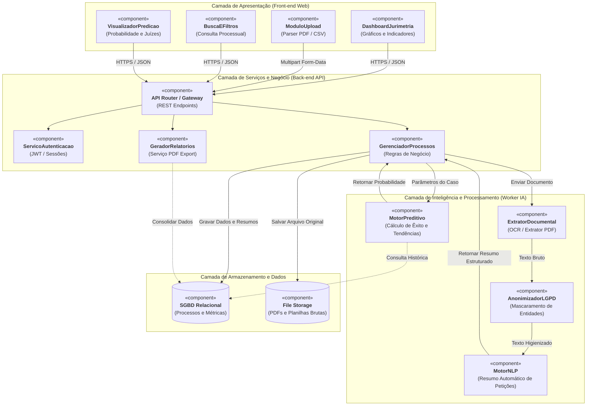
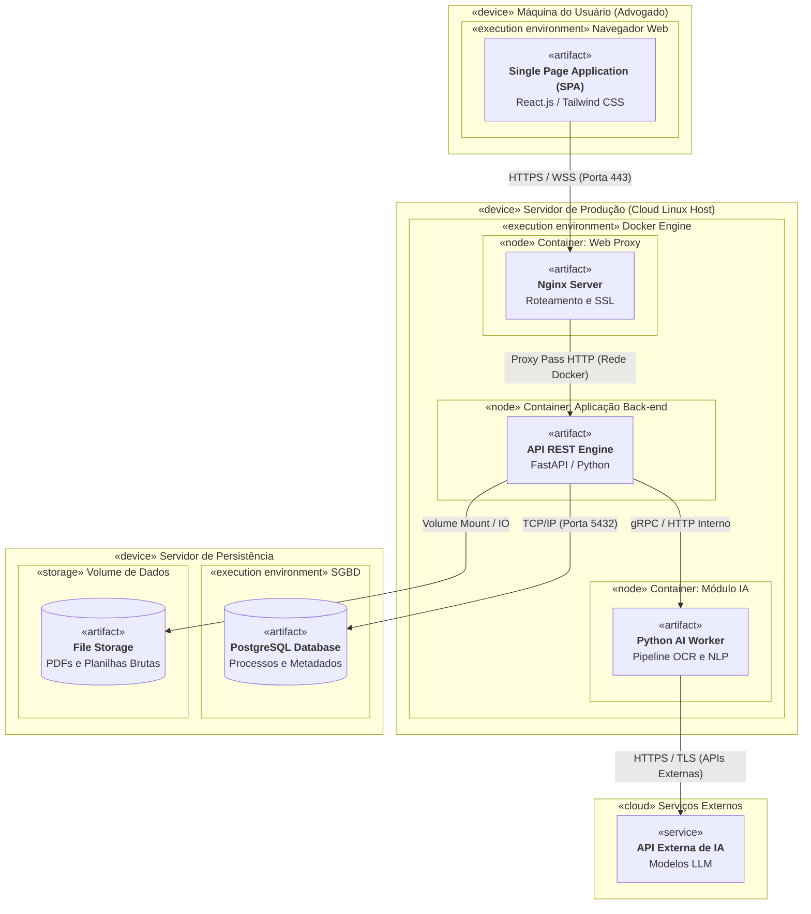

# Especificação Arquitetural e Técnica — Plataforma Jurimetria (Equipe Epsilon)

> **Projeto Avaliativo da Disciplina de Gerência de Projetos (Prof. Rafael De Amorim) — UFAL**  
> **Objetivo:** Sistema inteligente de jurimetria preditiva e organização processual para advogados.

---

## 1. Visão Geral do Produto e MVP

A plataforma resolve a sobrecarga de análise processual manual de escritórios de advocacia através de:

1. **Ingestão Híbrida:** Upload de peças em PDF (fluxo principal) e importação em lote via planilhas CSV.
2. **Esteira de Dados Segura (LGPD):** Mascaramento de dados pessoais (CPFs, nomes reais, partes) antes de qualquer persistência ou consulta externa.
3. **Extração e Sumarização (NLP):** Leitura via OCR/Parser com geração de resumo factual do processo.
4. **Predição Jurídica:** Cálculo estatístico de taxa de deferimento, tempo estimado de tramitação e perfil decisório do magistrado com base no histórico.
5. **Dashboard Interativo e Relatórios:** Gráficos de jurimetria e exportação de relatórios estratégicos em PDF.

---

## 2. Stack Tecnológica Oficial

- **Front-end (Dupla 1 — UI/UX):** React.js, Vite, Tailwind CSS, Recharts/Chart.js, Lucide Icons.
- **Back-end & Gateway (Dupla 2 — Arquitetura/API):** Python 3.11+, FastAPI, Pydantic v2, SQLAlchemy/SQLModel.
- **Engine de IA e Dados (Dupla 3 — Dados/IA):** Python 3.11+, pdfplumber / PyMuPDF (Parser), spaCy (NLP/Anonimização LGPD), Scikit-Learn (Predições).
- **Persistência & Cache:** PostgreSQL 16+, Redis (filas de processamento assíncrono).
- **Infraestrutura:** Docker, Docker Compose, Nginx (Proxy Reverso/SSL).

---

## 3. Estrutura do Monorepo Modular

```text
plataforma-jurimetria/
├── docker-compose.yml           # Orquestrador local de todos os serviços
├── ARCHITECTURE.md              # Este documento (fonte única da verdade técnica)
├── docs/                        # Diagramas, atas de reuniões e entregas acadêmicas
│   └── diagramas/
├── frontend/                    # [Dupla 1] Single Page Application (React)
│   ├── src/
│   │   ├── components/          # Componentes reutilizáveis (gráficos, filtros, modais)
│   │   ├── pages/               # Dashboard, Upload, Busca, Detalhes Processo
│   │   └── services/            # Clientes HTTP (Axios / Fetch tipado)
│   ├── package.json
│   └── Dockerfile
├── backend/                     # [Dupla 2] API Core e Gateway de Negócios
│   ├── app/
│   │   ├── routers/             # Rotas REST (/auth, /dashboard, /processos, /relatorios)
│   │   ├── schemas/             # Contratos Pydantic (Request / Response)
│   │   ├── models/              # Tabelas do banco de dados (ORM)
│   │   └── core/                # Configurações, segurança e conexão com banco
│   ├── requirements.txt
│   └── Dockerfile
└── ai_engine/                   # [Dupla 3] Worker Assíncrono de Dados e Machine Learning
    ├── pipelines/               # Parser PDF, Motor LGPD Regex/Spacy, NLP Summarizer
    ├── models/                  # Algoritmo preditivo de tendências e juízes
    ├── data/                    # Planilhas mockadas e bases de testes
    ├── worker.py                # Processamento de tarefas em background
    ├── requirements.txt
    └── Dockerfile

```

---

## 4. Pipeline de Processamento de Dados (Regra de Negócio)

Qualquer processo que entra na plataforma deve respeitar rigorosamente a ordem:
Upload (PDF/CSV) -> Extração de Texto -> Anonimizador LGPD -> Resumo NLP -> Modelo Preditivo -> Persistência (Banco)

> **Invariante Crítico de Segurança:** Nenhum dado textual com CPF, RG ou nome real de partes pode ser persistido ou retornado para a interface sem passar pela higienização do `AnonimizadorLGPD`.

---

## 5. Diagrama de Componentes (Arquitetura Lógica)



---

## 6. Diagrama de Implantação (Topologia de Infraestrutura)



---

## 7. Contratos Oficiais de API REST (Endpoints e Schemas)

### 7.1 Autenticação

- **Rota:** `POST /api/v1/auth/login`
- **Request Body (JSON):**

```json
{
  "email": "advogado@escritorio.com",
  "senha": "senhaSegura123"
}
```

- **Response Body (200 OK):**

```json
{
  "access_token": "eyJhbGciOi...",
  "token_type": "bearer",
  "usuario": {
    "id": "usr-01",
    "nome": "Lucas Gabriel",
    "oab": "12345/AL"
  }
}
```

### 7.2 Métricas de Jurimetria (Dashboard)

- **Rota:** `GET /api/v1/dashboard/metricas`
- **Response Body (200 OK):**

```json
{
  "taxa_exito_global": 0.684,
  "tempo_medio_tramitacao_meses": 14,
  "total_processos_analisados": 1248,
  "decisoes_por_juiz": [
    { "juiz": "Dr. Rafael De Amorim", "procedentes": 120, "improcedentes": 45 },
    { "juiz": "Dra. Maria Silva", "procedentes": 95, "improcedentes": 80 }
  ],
  "volume_por_tema": [
    { "tema": "Dano Moral", "percentual": 45 },
    { "tema": "Direito Trabalhista", "percentual": 25 },
    { "tema": "Plano de Saúde", "percentual": 20 },
    { "tema": "Tributário", "percentual": 10 }
  ]
}
```

### 7.3 Ingestão de Novo Processo (Upload de PDF)

- **Rota:** `POST /api/v1/processos/upload-pdf`
- **Content-Type:** `multipart/form-data` (campo: `file`)
- **Response Body (200 OK):**

```json
{
  "id_processo": "proc-88910",
  "arquivo_nome": "peticao_inicial_voo.pdf",
  "status": "PROCESSADO",
  "metadados_extraidos": {
    "numero_processo": "0019283-44.2026.8.02.0001",
    "tema": "Atraso de Voo / Indenização",
    "magistrado": "Dr. Rafael De Amorim",
    "comarca": "1ª Vara Cível de Maceió",
    "partes_anonimizadas": {
      "autor": "L. G. R. S. ***",
      "reu": "Companhia Aérea Linhas Brasil S.A."
    }
  },
  "resumo_nlp": "Ação de reparação civil contra transportadora aérea decorrente de cancelamento abusivo de voo internacional sem assistência emergencial ao passageiro.",
  "analise_preditiva": {
    "probabilidade_deferimento": 0.75,
    "margem_confianca": 0.08,
    "tempo_estimado_sentenca_meses": 9,
    "casos_similares_encontrados": 42,
    "tese_recomendada": "Aplicação prioritária do Código de Defesa do Consumidor e súmula sobre danos presumidos por falta de assistência.",
    "tendencia_juiz": "Magistrado possui histórico de 72% de decisões favoráveis ao consumidor neste padrão fático."
  }
}
```

### 7.4 Consulta e Base de Conhecimento

- **Rota:** `GET /api/v1/processos`
- **Query Parameters:** `?tema=Dano+Moral&juiz=Rafael&pagina=1&limite=10`
- **Response Body (200 OK):**

```json
{
  "total": 140,
  "pagina": 1,
  "itens": [
    {
      "id_processo": "proc-1002",
      "tema": "Dano Moral",
      "magistrado": "Dr. Rafael De Amorim",
      "partes_anonimizadas": "Felipe *** vs Banco Bradesco",
      "resultado": "Procedente",
      "data_julgamento": "2026-08-15"
    }
  ]
}
```

### 7.5 Exportação de Relatório Estratégico

- **Rota:** `GET /api/v1/relatorios/processo/{id_processo}/pdf`
- **Response:** Stream binário com `Content-Type: application/pdf`.