# Relatório Técnico Comparativo de Evolução Arquitetural, Funcional e de UX/UI — JuriVision

> **Projeto Acadêmico Avaliativo — Disciplina de Gerência de Projetos (Prof. Rafael De Amorim Silva)**  
> **Universidade Federal de Alagoas (UFAL) — Instituto de Computação (IC) — Equipe Epsilon**  
> **Responsável Técnico pela Reengenharia:** Victor Samyr (Dupla 2 — Back-end e Arquitetura, com atuação transversal Full-Stack e Qualidade)  
> **Referência de Comparação:** Branch Inicial (`main`) vs. Branch Evoluída (`feat/backend-core-arquitetura`)

---

## 1. Objetivo Executivo

Este documento apresenta o comparativo técnico, arquitetural e normativo entre a **Versão Inicial (`main`)** do repositório e a **Versão Evoluída e Certificada (`feat/backend-core-arquitetura`)**.

O trabalho de reengenharia teve como propósito transformar um repositório inicialmente composto por documentos preliminares (com divergências entre diagramas e infraestrutura) e esqueletos de código não funcionais em um **sistema completo, funcional de ponta a ponta, testado automaticamente e aderente às normas internacionais de Engenharia de Software e Usabilidade**:

- **Ciclo de Vida, Requisitos e Arquitetura:** `ISO/IEC/IEEE 12207`, `ISO/IEC/IEEE 29148` (IRP), `ISO/IEC/IEEE 42010` (Arquitetura e ADRs), `ISO/IEC 25010` (Qualidade de Produto SQuaRE), `UML 2.5` (OMG) e `CMMI-DEV / MPS.BR` (Rastreabilidade REQM e Gerência de Configuração CM).
- **Testes e Verificação:** `ISO/IEC/IEEE 29119` (`11` suítes de testes automatizados em `pytest` cobrindo `CT-01` a `CT-09` e inspeção de acessibilidade).
- **Engenharia de UX/UI e Direção Visual Jurídica:** `ISO 9241-110/112`, `W3C WCAG 2.2 Nível AA`, `WAI-ARIA 1.2`, *10 Heurísticas de Nielsen*, *Leis de UX* e o paradigma **Legal Editorial + Legal Intelligence** voltado à advocacia e pesquisa jurisprudencial.

### 1.1 Indicadores Quantitativos da Evolução (`git diff main..feat/backend-core-arquitetura`)

| Métrica de Evolução | Versão Inicial (`main`) | Versão Evoluída (`feat/backend-core-arquitetura`) |
| :--- | :---: | :---: |
| **Arquivos de Código e Documentação Ativos** | 12 arquivos (5 diretórios vazios com `.gitkeep`) | **29 arquivos implementados e sincronizados** (`+6.920` linhas) |
| **Endpoints REST Implementados no Back-end** | `1` (`/health` estático) | **`8` endpoints oficiais** (`auth`, `dashboard`, `upload-pdf`, `upload-csv`, `processos`, `relatorios/pdf`) |
| **Tabelas Relacionais Modeladas (ORM + MER)** | `0` (inexistente) | **`4` entidades relacionais** (`usuarios`, `processos`, `analises_ia`, `logs_auditoria_lgpd`) |
| **Cobertura de Requisitos Funcionais (`RF-01` a `RF-09`)** | `0%` (apenas simulação visual parcial) | **`100%` implementados no Back-end e integrados ao Front-end** |
| **Testes Automatizados (`ISO/IEC/IEEE 29119`)** | `0` testes | **`11` testes automatizados (`11 passed`)** em `pytest` |
| **Não Conformidades de UX/Acessibilidade (`WCAG 2.2 AA`)** | `12` falhas identificadas na auditoria | **`0` não conformidades** (`100%` saneadas e verificadas por teste) |

---

## 2. Comparativo Detalhado por Camada e Disciplina de Engenharia

### 2.1 Arquitetura de Software e Infraestrutura (`ARCHITECTURE.md`, `docker-compose.yml`, `.env.example`)

| Aspecto Arquitetural | Como era na Versão Inicial (`main`) | Como ficou na Versão Evoluída (`feat/backend-core-arquitetura`) |
| :--- | :--- | :--- |
| **Padronização de Identidade** | Conflito de nomenclatura: `README.md` e `.env.example` chamavam o projeto de **"JurisAI"**, enquanto `ARCHITECTURE.md` e `frontend/index.html` usavam **"JuriVision"**. | Identidade unificada como **JuriVision** em todos os artefatos (`README.md`, `.env.example`, `docker-compose.yml`, `ARCHITECTURE.md`, `docs/`). |
| **Comunicação entre Serviços (`ADR-001`)** | Contradição arquitetural grave: `ARCHITECTURE.md` declarava comunicação REST, mas o Diagrama de Sequência em `docs/MODELING.md` exigia **Fila de Mensageria Assíncrona (Redis/RabbitMQ)** inexistente no `docker-compose.yml`. | Formalizado o **`ADR-001`**: comunicação interna via **HTTP/REST síncrono** na rede isolada `jurivision-net` (`backend:8000` → `ai_engine:8001`), eliminando dependências fantasmas de mensageria. |
| **Acoplamento com o Motor de IA (`ADR-002`)** | O motor de IA era descrito como rigidamente dependente de bibliotecas fixas (`Spacy / Scikit-learn`) e sem estratégia de contingência caso o serviço de IA ou chaves de LLM não estivessem disponíveis. | Formalizado e implementado o **`ADR-002` (Padrão *Port & Adapter / Strategy*)**: o Back-end comunica-se através da interface `AIProviderAdapter`, suportando **Modelo Heurístico/Estatístico Determinístico Local (`AI_PROVIDER=local`)**, microserviço HTTP interno (`ai_engine:8001`) ou APIs externas (`gemini` / `openai`) com *fallback* automático. |
| **Barreira de Privacidade e LGPD (`RN-01`)** | Citada apenas superficialmente em texto, sem definição de onde ocorria a anonimização ou como evitar o envio de dados sensíveis a terceiros. | Implementada a **Barreira Local Obrigatória LGPD (`AnonimizadorLGPD`)**: todo documento PDF ou CSV tem CPFs, RGs e nomes de pessoas físicas mascarados localmente via Regex determinístico **antes** de qualquer persistência ou chamada ao motor de IA, gerando registro auditável com hash `SHA-256`. |
| **Acesso ao Banco de Dados (`ADR-003`)** | No `ARCHITECTURE.md` original, o container `ai_engine` aparecia conectado diretamente ao `PostgreSQL`, violando o encapsulamento de domínio. | Formalizado o **`ADR-003`**: apenas o **Back-end Core (`backend`)** detém conexão e transação com o banco relacional; o `ai_engine` opera de modo *stateless*. |
| **Modelagem de Dados (`MER/DER`)** | Inexistente no repositório original. | Especificado o **Modelo Entidade-Relacionamento (`MER/DER`)** em `ARCHITECTURE.md` e implementado via SQLAlchemy 2.0 (`usuarios`, `processos`, `analises_ia`, `logs_auditoria_lgpd`). |
| **Contratos de API REST** | Incompletos: faltavam o endpoint de importação em lote CSV (`POST /api/v1/processos/upload-csv`), o endpoint de detalhe (`GET /api/v1/processos/{id}`) e o contrato interno (`/internal/v1/analyze`). | Todos os contratos de entrada, saída e códigos de erro (`200`, `201`, `401`, `404`, `422`) foram formalizados na Seção 8 de `ARCHITECTURE.md`. |

#### Evolução Topológica da Arquitetura

```mermaid
flowchart TB
    subgraph Antes ["Versão Inicial (main) — Inconsistente e Incompleta"]
        direction LR
        FE_Old["Front-end Estático<br/>(Sem chamadas HTTP / Mock setTimeout)"]
        BE_Old["Back-end Esqueleto<br/>(Apenas /health, pastas vazias)"]
        Queue_Ghost["Fila Fantasma (Redis/RabbitMQ)<br/>(Citada no UML, ausente no Docker)"]
        AI_Old["AI Worker Acoplado<br/>(Apenas loop sleep sem HTTP)"]
        DB_Old[("PostgreSQL<br/>(Sem tabelas ou ORM)")]

        FE_Old -. "Sem integração" .-> BE_Old
        BE_Old -. "Divergência UML" .-> Queue_Ghost
        AI_Old -. "Acoplamento direto" .-> DB_Old
    end

    subgraph Depois ["Versão Evoluída (feat/backend-core-arquitetura) — ISO 42010 & ADRs"]
        direction LR
        FE_New["Front-end Legal Editorial<br/>(ES Modules + WCAG 2.2 AA)"]
        BE_New["Back-end Core (FastAPI)<br/>Auth JWT + ORM + PDF Stream"]
        LGPD_Gate["Barreira Local LGPD<br/>(Anonimizador Determinístico)"]
        Adapter["AIProviderAdapter (ADR-002)<br/>Fallback Local + Gateway HTTP"]
        AI_New["AI Engine (:8001)<br/>(Stateless / Plugável)"]
        DB_New[("Banco Relacional (ADR-003)<br/>4 Tabelas + Seed Auditado")]

        FE_New == "REST JSON / PDF" ==> BE_New
        BE_New --> LGPD_Gate
        LGPD_Gate --> Adapter
        Adapter == "HTTP Interno (ADR-001)" ==> AI_New
        BE_New == "SQLAlchemy 2.0" ==> DB_New
    end
```

---

### 2.2 Engenharia de Requisitos e Modelagem UML 2.5 (`docs/MODELING.md`)

| Artefato de Modelagem | Como era na Versão Inicial (`main`) | Como ficou na Versão Evoluída (`feat/backend-core-arquitetura`) |
| :--- | :--- | :--- |
| **Especificação de Requisitos (`IRP` — `ISO/IEC/IEEE 29148`)** | Não existia tabela ou lista de requisitos no documento; o arquivo iniciava diretamente nos diagramas Mermaid. | Criada a **Seção 2 (IRP Formal)** contendo **9 Requisitos Funcionais (`RF-01` a `RF-09`)**, **10 Requisitos Não Funcionais (`RNF-01` a `RNF-10`)** vinculados à `ISO/IEC 25010`, `ISO 9241` e `WCAG 2.2 AA`, e **4 Regras de Negócio (`RN-01` a `RN-04`)**. |
| **Diagrama de Casos de Uso (`UML 2.5`)** | Uso incorreto da semântica UML: setas `<<include>>` e `<<extend>>` invertidas, tratando etapas internas sequenciais de algoritmo como casos de uso independentes. | Reconstruído segundo a **OMG UML 2.5**: fronteira de sistema clara, atores primários e secundários, `<<include>>` obrigatório para a higienização LGPD (`UC04`) e `<<extend>>` condicional para exportação de relatório PDF (`UC09`). |
| **Diagramas de Atividades, Sequência e Estados** | Descreviam filas assíncronas inexistentes e omitiam o fluxo de importação CSV (`RF-03`), a validação de integridade de arquivos (`RN-04`) e o *fallback* local de IA (`ADR-002`). | Todos os 3 diagramas comportamentais foram reescritos em total simetria com os endpoints FastAPI, o esquema do banco de dados e a arquitetura `Port & Adapter`. |
| **Matriz de Rastreabilidade (`CMMI REQM`)** | Inexistente. | Criada a **Seção 7 (Matriz de Rastreabilidade Bidirecional)** conectando cada `RF` a Casos de Uso (`UC`), Estados, Componentes de UI, Endpoints REST e Casos de Teste (`CT-01` a `CT-09`). |

---

### 2.3 Implementação do Back-end Core e Testes (`backend/`)

Na versão inicial (`main`), o diretório `backend/app/` continha apenas um arquivo `main.py` de 20 linhas e pastas vazias (`core/`, `models/`, `routers/`, `schemas/`, `tests/`). Na versão evoluída, toda a engenharia de servidor foi construída:

1. **[`backend/app/core/config.py`](../backend/app/core/config.py) & [`database.py`](../backend/app/core/database.py):** Gestão centralizada de variáveis de ambiente e sessão transacional SQLAlchemy 2.0 com suporte transparente a `PostgreSQL` (via Docker) e `SQLite` (para desenvolvimento local e execução rápida de testes).
2. **[`backend/app/models/entities.py`](../backend/app/models/entities.py) & [`seed.py`](../backend/app/core/seed.py):** Modelagem ORM das tabelas `usuarios`, `processos`, `analises_ia` e `logs_auditoria_lgpd`, acompanhada de *seed* automático idempotente com 10 processos higienizados do Tribunal de Justiça de Alagoas (`TJAL`).
3. **[`backend/app/core/ai_gateway.py`](../backend/app/core/ai_gateway.py):**
   - `ExtratorDocumental`: Validação rigorosa de assinatura binária `%PDF-` (`RN-04`) e extração textual via `pdfplumber`.
   - `AnonimizadorLGPD`: Higienização determinística local de CPFs (`***.***.***-**`), RGs e nomes de partes civis (`RN-01`), gerando hash `SHA-256` auditável.
   - `LocalDeterministicFallbackAdapter` & `HttpAIEngineGatewayClient`: Isolamento completo do motor de IA (`ADR-002`).
4. **Routers REST ([`auth.py`](../backend/app/routers/auth.py), [`dashboard.py`](../backend/app/routers/dashboard.py), [`processos.py`](../backend/app/routers/processos.py), [`relatorios.py`](../backend/app/routers/relatorios.py)):** Implementação integral de todos os contratos da API, incluindo geração dinâmica de relatórios em stream binário PDF (`application/pdf` — `RF-09`).
5. **Verificação Automatizada ([`test_api_contracts.py`](../backend/tests/test_api_contracts.py) e [`test_frontend_accessibility.py`](../backend/tests/test_frontend_accessibility.py)):** `11` suítes de testes automatizados validando todos os fluxos de sucesso, recusas `401`/`404`/`422`, anonimização LGPD e conformidade de interface.

---

### 2.4 Engenharia de UX/UI, Acessibilidade e Direção Visual (*Legal Editorial + Legal Intelligence*)

A interface do usuário (`frontend/`) passou pela transformação mais visível do projeto, evoluindo de um mock estático com aparência de template genérico de IA para uma **plataforma de pesquisa jurisprudencial e jurimetria voltada à prática da advocacia**:

| Dimensão de UX/UI | Versão Inicial (`main`) | Versão Evoluída (`feat/backend-core-arquitetura`) |
| :--- | :--- | :--- |
| **Posicionamento e Fluxo Principal** | Iniciava em um dashboard genérico de KPIs; a tabela de processos era secundária e estática (apenas 3 linhas fixas no HTML). | **Princípio "Pesquisa antes de Visualização":** inicia na **Pesquisa de Jurisprudência e Precedentes**, com câmara de busca, atalhos de pesquisas recentes, filtros progressivos e transição contextual para a **Análise Jurimétrica**. |
| **Direção Estética e Tipografia** | Template Tailwind escuro/azul padrão com ícones FontAwesome em todos os títulos, cartões inflados com `border-l-4` coloridas e badges tipo "semáforo". | **Direção *Legal Editorial + Legal Intelligence*:** paleta clara e institucional em **Azul profundo (`#20364A`)**, **Marfim editorial (`#F6F4EF`)**, **Branco (`#FFFFFF`)**, **Verde acinzentado (`#58796D`)** e **Areia dourada (`#B29A74`)**; tipografia editorial **`Source Serif 4`** combinada com **`Inter`**; zero dependência de Tailwind CDN ou FontAwesome. |
| **Apresentação de Decisões e Leitura** | Registros comprimidos em uma tabela simples sem opção de abrir o documento completo, salvar ou copiar citação. | **Cartões Documentais de Decisão** (com opção de alternar para **Tabela Comparativa**), **Folha Individual de Leitura de Decisão** (`max-width: 860px`, largura confortável de `65–75ch`), **Biblioteca de Decisões Salvas** e ação de **Copiar Referência** padronizada. |
| **Linguagem e Transparência Metodológica** | Apresentava "Probabilidade de Êxito" isolada sem explicar universo, denominador ou limitações. | **Linguagem jurídica familiar e ética:** separa visualmente metadados extraídos, síntese gerada automaticamente e estatística comparativa; exibe **denominadores explícitos** em todos os percentuais e gráficos; permite **clicar em qualquer magistrado ou assunto no gráfico para abrir as decisões que compõem o indicador**; inclui notas metodológicas e avisos de neutralidade jurídica. |
| **Integração e Funcionalidades (`RF-01` a `RF-09`)** | `setTimeout` falso de 2.5s; não enviava arquivos reais; não suportava CSV (`RF-03`), login (`RF-01`), filtros reais (`RF-08`) nem exportação de PDF (`RF-09`). | **Integração HTTP Real (`frontend/src/services/api.js`):** upload real de `.PDF` e `.CSV`, autenticação JWT do advogado, filtros e ordenação dinâmicos, paginação e download de relatórios em PDF. |
| **Acessibilidade (`WCAG 2.2 AA` & `WAI-ARIA 1.2`)** | Dropzone `
` inacessível via teclado (`NC-UX-01`), inputs sem `<label>`, gráficos `<canvas>` cegos para leitores de tela e ausência de `role="tablist"`. | Controles nativos `<input type="file">` com `<label>`, padrão completo `WAI-ARIA 1.2 Tabs` com navegação por setas, tabelas acessíveis equivalentes para cada gráfico (`WCAG 1.1.1`), região viva `aria-live="polite"` e contraste certificado. |

---

## 3. Resumo dos Arquivos Criados e Modificados

- **Governança e Especificação:**
  - [`ARCHITECTURE.md`](../ARCHITECTURE.md) *(Reescrito e expandido com ISO 42010, ADRs 001–003, MER/DER e Contratos REST)*
  - [`docs/MODELING.md`](./MODELING.md) *(Reescrito com IRP ISO 29148, Engenharia de UX/UI, Diagramas UML 2.5 corrigidos e Matriz de Rastreabilidade)*
  - [`docs/MANAGEMENT.md`](./MANAGEMENT.md), [`README.md`](../README.md), [`agent.md`](../agent.md), [`.env.example`](../.env.example), [`docker-compose.yml`](../docker-compose.yml)
- **Back-end Core (`backend/`):**
  - [`backend/app/main.py`](../backend/app/main.py), [`backend/requirements.txt`](../backend/requirements.txt)
  - [`backend/app/core/config.py`](../backend/app/core/config.py), [`database.py`](../backend/app/core/database.py), [`security.py`](../backend/app/core/security.py), [`ai_gateway.py`](../backend/app/core/ai_gateway.py), [`seed.py`](../backend/app/core/seed.py)
  - [`backend/app/models/entities.py`](../backend/app/models/entities.py), [`backend/app/schemas/contracts.py`](../backend/app/schemas/contracts.py)
  - [`backend/app/routers/auth.py`](../backend/app/routers/auth.py), [`dashboard.py`](../backend/app/routers/dashboard.py), [`processos.py`](../backend/app/routers/processos.py), [`relatorios.py`](../backend/app/routers/relatorios.py)
- **Front-end *Legal Editorial + Legal Intelligence* (`frontend/`):**
  - [`frontend/index.html`](../frontend/index.html)
  - [`frontend/src/components/design-tokens.css`](../frontend/src/components/design-tokens.css)
  - [`frontend/src/app.js`](../frontend/src/app.js)
  - [`frontend/src/services/api.js`](../frontend/src/services/api.js)
- **Suíte de Verificação Automatizada (`backend/tests/`):**
  - [`backend/tests/test_api_contracts.py`](../backend/tests/test_api_contracts.py)
  - [`backend/tests/test_frontend_accessibility.py`](../backend/tests/test_frontend_accessibility.py)
