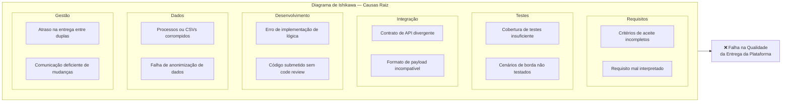
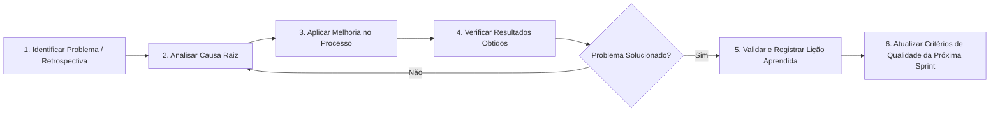
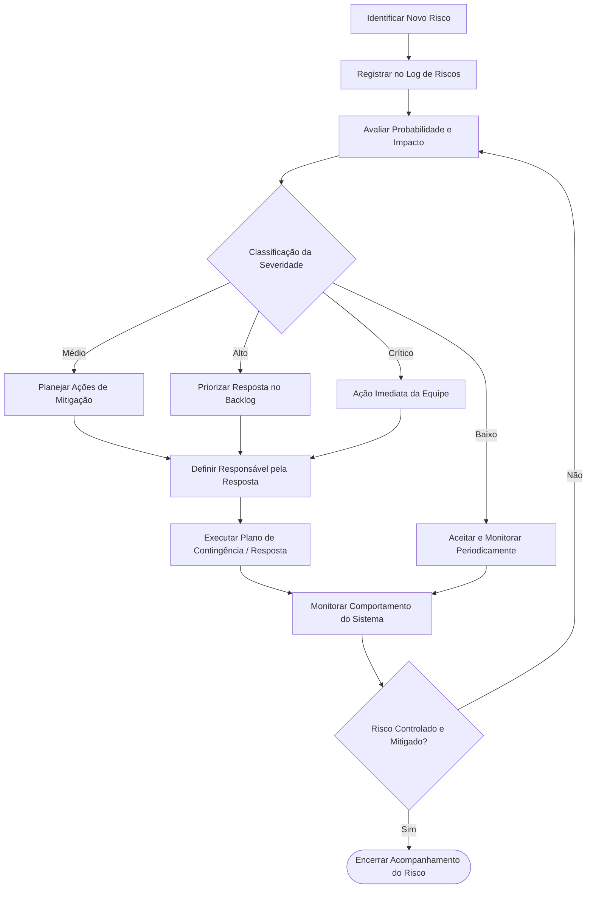
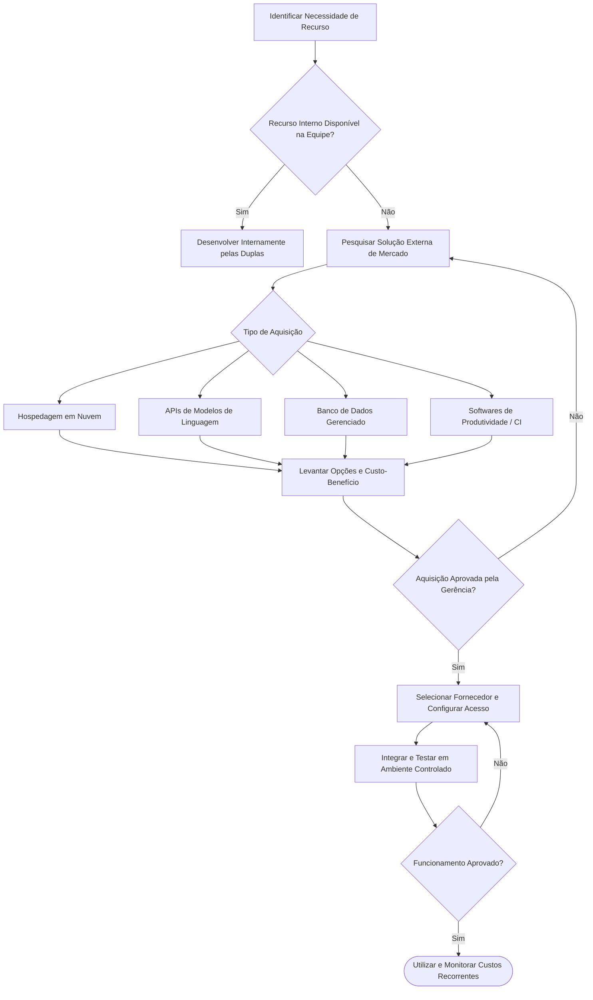

# Plano de Gestão, Governança e Controle do Projeto

> **Projeto:** Plataforma Analítica e Preditiva para Gestão de Processos Jurídicos  
> **Disciplina:** Gerência de Projetos — Prof. Rafael De Amorim Silva  
> **Instituição:** Universidade Federal de Alagoas (UFAL) — Instituto de Computação (IC)  
> **Equipe Epsilon:** Daniel Filipe, Emanuele Vitória, Fernando Gabriel, Gabriel Damião, Lucas Gabriel, Pedro Henrique, Victor Samyr, Ygor Vasconcelos.

---

## 1. Visão Geral da Governança

Este documento consolida a camada de **Governança, Controle e Planejamento (PMBOK / Metodologia Ágil/XP)** do projeto. Enquanto o `ARCHITECTURE.md` descreve os componentes estáticos e o `MODELING.md` detalha a lógica comportamental do software, este artefato define:

1. **Alocação de Recursos e Responsabilidades:** Organização das 4 duplas e Matriz RACI.
2. **Estrutura de Decomposição do Trabalho:** Estrutura Analítica do Projeto (EAP / WBS).
3. **Garantia e Controle da Qualidade:** Diagrama de Ishikawa, fluxo de inspeção técnica e ciclo PDCA.
4. **Gestão Preventiva de Riscos:** Estrutura Analítica de Riscos (EAR), Matriz Probabilidade $\times$ Impacto e fluxo de mitigação.
5. **Comunicações e Aquisições:** Ritos de alinhamento, matriz de contatos e fluxo decisório *Make or Buy*.
6. **Planejamento Temporal e Custos:** Diagrama de dependências, estimativas de duração (PERT/EDA) e orçamento consolidado.

---

## 2. Estrutura Organizacional e Matriz RACI

### 2.1 Alocação por Duplas Especializadas

Para otimizar o fluxo de trabalho e evitar sobreposições técnicas, os 8 integrantes foram distribuídos em 4 duplas multifuncionais com fronteiras claras de atuação:

* **Dupla 1 — Front-end e UI/UX:** Emanuele Vitória e Lucas Gabriel  
  * *Foco:* Interface web em React/Tailwind, protótipos de alta fidelidade, dashboard de jurimetria, tela de upload e visualização de filtros.
* **Dupla 2 — Back-end e Arquitetura:** Victor Samyr e Gabriel Damião  
  * *Foco:* API REST em FastAPI, modelagem do banco relacional PostgreSQL, autenticação JWT, integração entre módulos e persistência.
* **Dupla 3 — Dados e Inteligência Artificial:** Pedro Henrique e Ygor Vasconcelos  
  * *Foco:* Pipeline de OCR/leitura de PDFs, motor de anonimização (LGPD), sumarização em linguagem natural (NLP) e modelo preditivo de êxito.
* **Dupla 4 — Gerência de Projetos e Requisitos:** Daniel Filipe e Fernando Gabriel  
  * *Foco:* Coordenação de prazos, definição de critérios de aceite, controle de riscos, garantia de qualidade e elaboração de artefatos formais.

### 2.2 Matriz RACI do Projeto

Legenda:
* **R (Responsible):** Quem executa a atividade.
* **A (Accountable):** Quem aprova o resultado da entrega.
* **C (Consulted):** Quem deve ser consultado antes/durante a execução.
* **I (Informed):** Quem deve ser mantido informado sobre o status.

| Atividade / Pacote de Entrega | Gerência (D4) | UI/UX (D1) | Back-end (D2) | Dados/IA (D3) |
| :--- | :---: | :---: | :---: | :---: |
| **Definição de Requisitos e Escopo** | **R / A** | C | C | C |
| **Planejamento e Acompanhamento das Sprints** | **R / A** | I | I | I |
| **Construção de Telas, Filtros e Gráficos** | C | **R / A** | C | I |
| **Processamento e Métricas de Jurimetria** | C | R | **R / A** | C |
| **Desenvolvimento da API REST e Arquitetura** | I | C | **R / A** | C |
| **Implementação de Upload e Validação de Arquivos** | I | I | **R / A** | C |
| **Estruturação, Limpeza e Higienização de Dados** | I | I | C | **R / A** |
| **Identificação e Mascaramento de Dados (LGPD)** | C | I | C | **R / A** |
| **Sumarização Processual com PLN/NLP** | I | I | C | **R / A** |
| **Desenvolvimento dos Modelos de Predição** | C | I | C | **R / A** |
| **Geração de Relatórios Estratégicos em PDF** | C | I | R | **R / A** |
| **Integração de Módulos e Testes de Homologação** | **A** | R | R | R |
| **Documentação Final e Apresentações Acadêmicas** | **R / A** | C | C | C |

---

## 3. Estrutura Analítica do Projeto (EAP / WBS)

A EAP decompõe 100% do escopo do projeto em 5 grandes fases e seus respectivos pacotes de trabalho:

```mermaid
flowchart TD
    Root["Plataforma Jurídica (EAP)"]

    %% Nível 1
    P1["1.1 Gerenciamento do Projeto"]
    P2["1.2 Interface e Front-end"]
    P3["1.3 API e Back-end"]
    P4["1.4 Dados e Inteligência Artificial"]
    P5["1.5 Homologação e Implantação"]

    Root --> P1
    Root --> P2
    Root --> P3
    Root --> P4
    Root --> P5

    %% 1.1 Gerenciamento
    P1 --> P11["1.1.1 Documentação de Planejamento<br/>(TAP, PGP, Matriz Requisitos)"]
    P1 --> P12["1.1.2 Monitoramento e Controle<br/>(Atas, Dailies, Relatórios de Sprints)"]
    P1 --> P13["1.1.3 Encerramento<br/>(Relatório Final, Lições Aprendidas)"]

    %% 1.2 Front-end
    P2 --> P21["1.2.1 Protótipos UI/UX<br/>(Upload, Dashboard, Painel Preditivo)"]
    P2 --> P22["1.2.2 Código-Fonte Interface Web<br/>(Telas de Ingestão, Dashboard, Filtros, Exportação)"]

    %% 1.3 Back-end
    P3 --> P31["1.3.1 Armazenamento<br/>(Modelo Relacional, Banco Estruturado)"]
    P3 --> P32["1.3.2 API REST<br/>(Serviço de Ingestão, Endpoints, Geração PDF)"]

    %% 1.4 Dados e IA
    P4 --> P41["1.4.1 Anonimização LGPD<br/>(Algoritmo de Mascaramento, Base Segura)"]
    P4 --> P42["1.4.2 Processamento de Linguagem Natural<br/>(Algoritmo de Resumos NLP, Base Estruturada)"]
    P4 --> P43["1.4.3 Modelos Preditivos<br/>(Classificador de Decisões, Algoritmo de Predição)"]

    %% 1.5 Homologação
    P5 --> P51["1.5.1 Garantia de Qualidade<br/>(Casos de Teste, Relatório de Testes)"]
    P5 --> P52["1.5.2 Infraestrutura e Deploy<br/>(Automação Docker, Ambiente de Produção)"]
```



---

## 4. Gestão da Qualidade

### 4.1 Diagrama de Causa e Efeito (Ishikawa)

Para mitigar proativamente o problema central de **Falha na Qualidade da Entrega**, a equipe mapeou as causas-raiz potenciais adaptadas à Engenharia de Software:



### 4.2 Fluxo de Inspeção e Critérios de Aceite (Definition of Done)

Nenhuma tarefa é considerada concluída sem cumprir o fluxo rigoroso de verificação técnica:

```mermaid
flowchart TD
    E0[Entrega Desenvolvida pela Dupla] --> E1[Revisão Técnica / Code Review por Par]
    E1 --> E2[Execução de Testes Unitários Locais]
    E2 --> E3{Atende aos Critérios<br/>de Aceite (DoD)?}
    
    E3 -- Não --> R1[Registrar Não Conformidade]
    R1 --> R2[Corrigir Funcionalidade]
    R2 --> E1
    
    E3 -- Sim --> E4[Testes de Integração entre Módulos]
    E4 --> E5{Integração<br/>Aprovada sem Erros?}
    
    E5 -- Não --> R1
    E5 -- Sim --> E6[Validar Entrega com a Gerência]
    E6 --> E7([✅ Entrega Aprovada / Merge na Main])
```

### 4.3 Ciclo de Melhoria Contínua (PDCA)



---

## 5. Gestão de Riscos

### 5.1 Estrutura Analítica de Riscos (EAR)

```mermaid
flowchart TD
    EAR["Riscos do Projeto"]
    
    EAR --> R_TEC["1. Riscos Técnicos"]
    R_TEC --> T1["Falha nos endpoints da API REST"]
    R_TEC --> T2["Erro no parser/OCR de leitura de PDF"]
    R_TEC --> T3["Falha no parsing de planilhas CSV"]
    
    EAR --> R_GER["2. Riscos Gerenciais"]
    R_GER --> G1["Atraso no cronograma das Sprints"]
    R_GER --> G2["Indisponibilidade pontual de integrantes"]
    R_GER --> G3["Bloqueio por dependência entre duplas"]
    
    EAR --> R_LGPD["3. Riscos de Dados & LGPD"]
    R_LGPD --> L1["Vazamento de dados sensíveis não anonimizados"]
    R_LGPD --> L2["Inconsistência nos registros judiciais mockados"]
    R_LGPD --> L3["Resultado preditivo com viés ou distorção"]
    
    EAR --> R_INT["4. Riscos de Integração"]
    R_INT --> I1["Front-end incompatível com schema da API"]
    R_INT --> I2["API incompatível com retornos do Worker de IA"]
    R_INT --> I3["Quebra de formato em relatórios exportados"]
```



### 5.2 Matriz Probabilidade $\times$ Impacto e Respostas

A severidade orienta o esforço prioritário da equipe:

| Severidade | Risco Mapeado | Probabilidade | Impacto | Estratégia de Resposta |
| :--- | :--- | :---: | :---: | :--- |
| **Crítico** | Falha na anonimização de dados (Violação LGPD) | Média | Alto | **Ação Imediata:** Testes automatizados obrigatórios de Regex/NLP antes de qualquer gravação no banco. |
| **Alto** | Atraso na integração de contratos entre módulos | Média | Alto | **Mitigar:** Contratos Pydantic congelados como fonte única da verdade técnica. |
| **Alto** | Perda ou inconsistência de dados durante a ingestão | Baixa | Alto | **Mitigar:** Validações rigorosas de schema na camada de entrada da API. |
| **Médio** | Falha no processamento de PDFs complexos ou digitalizados | Alta | Médio | **Mitigar:** Fallback estruturado com mensagens claras ao usuário e suporte a CSVs. |
| **Médio** | Problemas na formatação de exportação de relatórios | Média | Médio | **Mitigar:** Geração orientada a templates padronizados. |
| **Baixo** | Inconsistências cosméticas de layout e documentação | Média | Baixo | **Aceitar:** Ajustes incrementais ao longo das revisões de Sprint. |

### 5.3 Fluxo Operacional de Tratamento de Riscos



---

## 6. Gestão de Comunicações e Aquisições

### 6.1 Matriz de Comunicação e Ritos Ágeis

| Evento / Canal | Objetivo | Periodicidade | Participantes | Saída Gerada |
| :--- | :--- | :--- | :--- | :--- |
| **Daily Stand-up** | Identificar impedimentos e alinhamento diário | Diária (15 min) | Integrantes das duplas | Desbloqueio de tarefas |
| **Sprint Review & Planning** | Validar entregas e planejar próxima iteração | Semanal | Toda a equipe | Backlog da Sprint atualizado |
| **Integração Técnica** | Alinhamento de contratos de API e payloads | Sob demanda | Duplas 1, 2 e 3 | Contratos Pydantic validados |
| **GitHub Issues & PRs** | Rastreamento formal de features e bugs | Contínuo | Toda a equipe | Histórico de aprovações (Code Review) |

### 6.2 Processo de Aquisições (*Make or Buy*)

Para cada insumo externo (hospedagem, modelos de IA, ferramentas), a equipe segue o fluxo decisório:



---

## 7. Planejamento Temporal, Esforço e Custos

### 7.1 Estimativa de Duração das Atividades (PERT / EDA)

O cronograma do projeto foi planejado com base na modelagem em 3 cenários de esforço:
* **Otimista ($O$):** 33 dias úteis (cenário sem bloqueios técnicos ou retrabalho).
* **Mais Provável / Razoável ($M$):** 39 dias úteis (ritmo operacional esperado).
* **Pessimista ($P$):** 49 dias úteis (cenário com falhas de integração e bugs complexos).

#### 1. Estimativa por Média Simples (EDA Simples)
$$EDA = \frac{O + M + P}{3} = \frac{33 + 39 + 49}{3} = \frac{121}{3} \approx 40{,}33 \text{ dias} \implies \mathbf{41\ dias\ úteis}$$

#### 2. Estimativa por Distribuição Beta (PERT / EDA Beta)
$$EDA_{\beta} = \frac{O + 4M + P}{6} = \frac{33 + 4(39) + 49}{6} = \frac{33 + 156 + 49}{6} = \frac{238}{6} \approx 39{,}67 \text{ dias} \implies \mathbf{40\ dias\ úteis}$$

#### 3. Distribuição Consolidada por Macroetapa

| Macroetapa | Otimista ($O$) | Provável ($M$) | Pessimista ($P$) | EDA Simples | EDA Beta |
| :--- | :---: | :---: | :---: | :---: | :---: |
| **1. Setup e Arquitetura** | 2 | 3 | 4 | 3,00 dias | 3,00 dias |
| **2. Autenticação e Login** | 8 | 9 | 11 | 9,33 dias | 9,17 dias |
| **3. Consulta e Busca** | 7 | 8 | 10 | 8,33 dias | 8,17 dias |
| **4. Upload e Ingestão** | 3 | 4 | 5 | 4,00 dias | 4,00 dias |
| **5. Inteligência Artificial** | 6 | 7 | 9 | 7,33 dias | 7,17 dias |
| **6. Finalização e Deploy** | 7 | 8 | 10 | 8,33 dias | 8,17 dias |
| **Total do Projeto** | **33** | **39** | **49** | **40,33 dias** | **39,67 dias** |

---

### 7.2 Quadro Orçamentário e Custos Consolidados

O modelo financeiro foi projetado considerando custos operacionais recorrentes e custo homem-hora das 4 duplas de desenvolvimento para um ciclo de 8 semanas:

#### 1. Premissas de Custo Hora por Especialidade

| Função | Valor / Hora | Horas Totais (8 Semanas) | Subtotal |
| :--- | :---: | :---: | :---: |
| **Gestor do Projeto (Dupla 4)** | R\$ 150,00 | 64 h | R\$ 9.600,00 |
| **Desenvolvedores Back-end (Dupla 2)** | R\$ 120,00 | 164 h | R\$ 19.680,00 |
| **Desenvolvedores Front-end (Dupla 1)** | R\$ 100,00 | 78 h | R\$ 7.800,00 |
| **Engenheiros de Dados e IA (Dupla 3)** | R\$ 110,00 | 148 h | R\$ 16.280,00 |
| **Total Esforço Equipe** | — | **454 h** | **R\$ 53.360,00** |

#### 2. Custos de Infraestrutura e Recorrentes (Período do Projeto)

| Categoria | Tipo | Valor Previsto | Valor Real / Realizado | Variação |
| :--- | :---: | :---: | :---: | :---: |
| **Hospedagem em Nuvem** | Recorrente | R\$ 5.000,00 | R\$ 5.000,00 | R\$ 0,00 |
| **APIs e Serviços de IA** | Recorrente | R\$ 3.000,00 | R\$ 3.180,00 | + R\$ 180,00 |
| **Armazenamento e Banco Gerenciado** | Recorrente | R\$ 2.400,00 | R\$ 2.400,00 | R\$ 0,00 |
| **Software e Ferramental** | Recorrente | R\$ 1.600,00 | R\$ 1.600,00 | R\$ 0,00 |
| **Domínio e Certificado SSL** | Recorrente | R\$ 400,00 | R\$ 400,00 | R\$ 0,00 |
| **Hardware e Infraestrutura Inicial** | Custo Único | R\$ 5.000,00 | R\$ 5.200,00 | + R\$ 200,00 |
| **Auditoria e Segurança LGPD** | Custo Único | R\$ 3.000,00 | R\$ 3.000,00 | R\$ 0,00 |
| **Homologação e Treinamento** | Custo Único | R\$ 4.000,00 | R\$ 3.800,00 | - R\$ 200,00 |
| **Reserva de Contingência** | Reserva | R\$ 2.500,00 | R\$ 1.200,00 | - R\$ 1.300,00 |
| **Total Geral Consolidado** | — | **R\$ 80.260,00** | **R\$ 79.140,00** | **- R\$ 1.120,00** |

> **Resultado Orçamentário:** A execução financeira real representou uma economia de **R\$ 1.120,00 (-1,4%)** em relação ao orçamento teto projetado, operando dentro das margens de segurança estabelecidas pela gerência.

---

## 8. Diretrizes de Governança para o Desenvolvimento com IA

Ao utilizar agentes autônomos de desenvolvimento (como o Google Antigravity):

1. **Rastreabilidade por Pacote da EAP:** Toda solicitação de código deve referenciar seu item correspondente (ex: *"Implementar pacote 1.4.1 — Anonimização LGPD"*).
2. **Checagem de Critérios de Aceite:** Nenhuma pull request gerada por agente deve ser incorporada sem passar pelo fluxo de inspeção definido na Seção 4.2.
3. **Respeito à Autonomia das Duplas:** O agente está estritamente proibido de alterar códigos fora do escopo da subpasta atribuída à sua respectiva dupla (`frontend/`, `backend/`, `ai_engine/`).