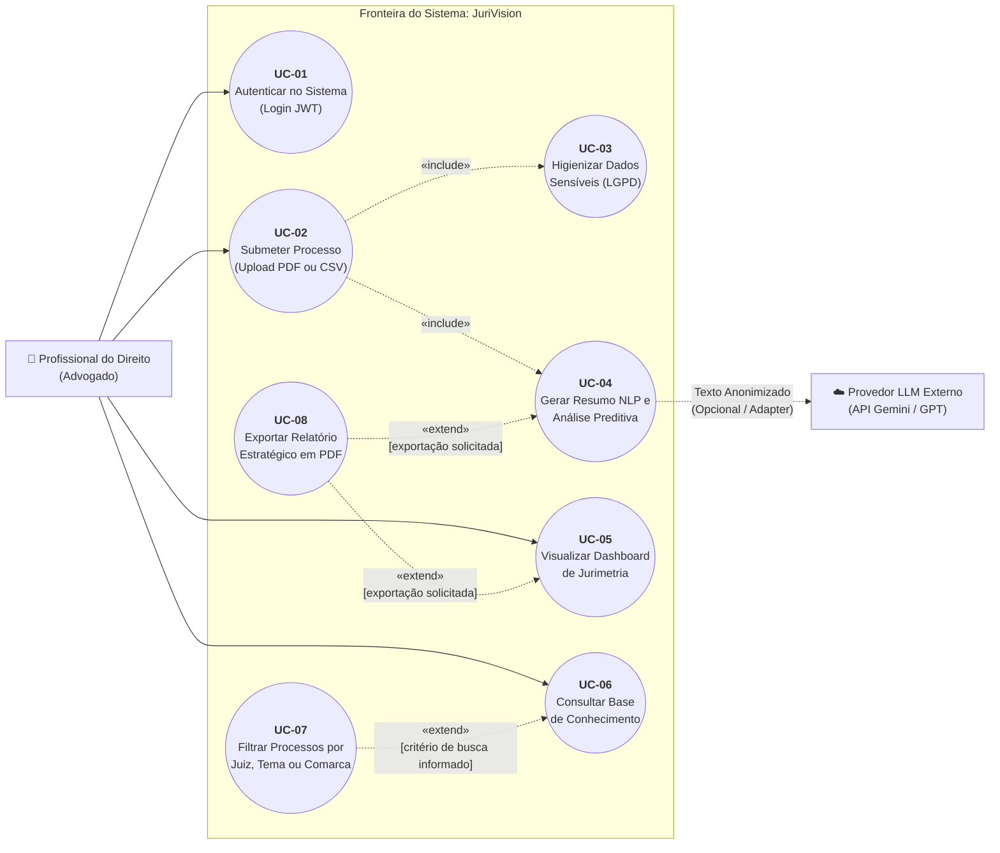
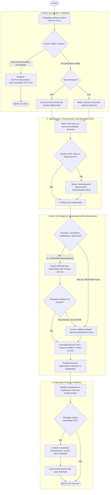
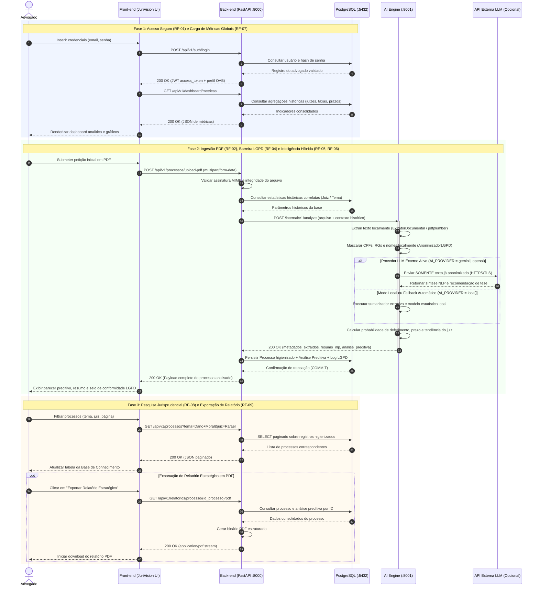
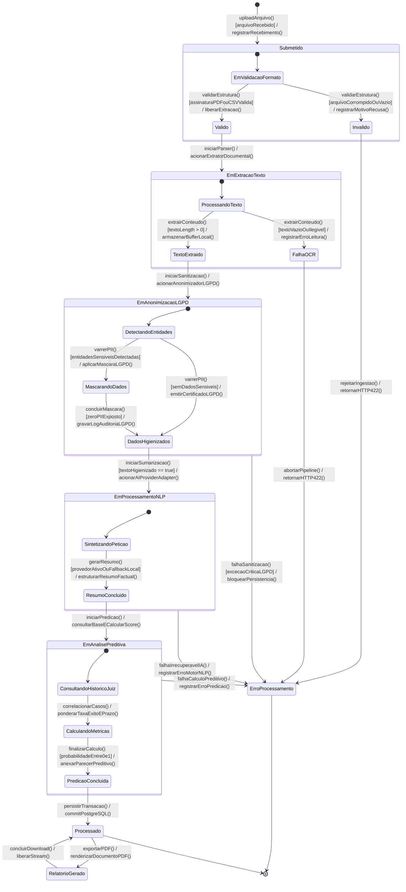

# Especificação de Requisitos (IRP), Modelagem UML 2.5 e Rastreabilidade — JuriVision

> **Projeto Avaliativo de Gerência de Projetos — Prof. Rafael De Amorim (UFAL)**  
> **Sistema:** JuriVision — Plataforma Analítica e Preditiva para Gestão de Processos Jurídicos (Equipe Epsilon)  
> **Normas de Referência:** ISO/IEC/IEEE 29148 (Requisitos/IRP), ISO/IEC 25010 (Qualidade de Produto), ISO 9241-11/110/112/210 (Ergonomia e Usabilidade), W3C WCAG 2.2 AA / WAI-ARIA 1.2 (Acessibilidade), UML 2.5 (OMG), ISO/IEC/IEEE 29119 (Testes) e CMMI-DEV REQM / MPS.BR (Rastreabilidade)

---

## 1. Visão Geral do Artefato

Enquanto o `ARCHITECTURE.md` estabelece a organização estática (ADRs, componentes, implantação, modelo de dados e contratos de API), este documento consolida:

1. **Especificação Formal de Requisitos (IRP — ISO/IEC/IEEE 29148):** Requisitos Funcionais (`RF`), Requisitos Não Funcionais (`RNF` baseados na **ISO/IEC 25010**) e Regras de Negócio (`RN`).
2. **Modelagem Comportamental Formal (UML 2.5 — OMG):** Diagrama de Casos de Uso (DCU), Diagrama de Atividades (DA), Diagrama de Sequência (DS) e Diagrama de Estados (DE).
3. **Matriz de Rastreabilidade Bidirecional (CMMI-DEV REQM / MPS.BR):** Vínculo ponta a ponta entre EAP, Requisitos, Casos de Uso, Estados, Componentes/Endpoints e Casos de Teste.

---

## 2. Especificação Formal de Requisitos — IRP (ISO/IEC/IEEE 29148)

### 2.1 Requisitos Funcionais (RF)

Todo requisito abaixo foi especificado para ser *necessário, não ambíguo, completo, consistente, factível, verificável e rastreável*:

| ID | Requisito Funcional | Descrição Normativa (`O sistema deve...`) | Prioridade | Critério Objetivo de Verificação |
| :--- | :--- | :--- | :---: | :--- |
| **RF-01** | Autenticação de Profissional do Direito | O sistema deve autenticar o advogado mediante `email` e `senha` (`POST /api/v1/auth/login`), emitindo token JWT e dados do perfil com registro OAB. | Alta | Credenciais válidas retornam HTTP `200 OK` com `access_token`; credenciais inválidas retornam HTTP `401 Unauthorized`. |
| **RF-02** | Ingestão e Extração de Petição em PDF | O sistema deve receber arquivos PDF (`POST /api/v1/processos/upload-pdf`), validar sua integridade e extrair localmente o texto e metadados processuais (número do processo, tema, magistrado, comarca e partes). | Alta | Upload de PDF íntegro extrai texto não vazio; arquivo inválido ou corrompido retorna HTTP `400`/`422`. |
| **RF-03** | Ingestão em Lote via Planilha CSV | O sistema deve permitir a importação em lote de processos estruturados via arquivo CSV (`POST /api/v1/processos/upload-csv`), validando as colunas obrigatórias. | Média | Upload de CSV válido retorna HTTP `200 OK` contabilizando total de registros lidos e importados. |
| **RF-04** | Anonimização Automática de Dados Sensíveis (LGPD) | O sistema deve identificar e mascarar localmente CPFs, RGs e nomes reais de partes pessoa física (`AnonimizadorLGPD`) antes de qualquer persistência no banco ou chamada a API externa de IA. | Crítica | 100% dos CPFs/RGs e nomes de pessoas físicas em textos de teste são substituídos por máscaras (`***` / `[CPF_ANONIMIZADO]`). |
| **RF-05** | Sumarização Factual por NLP | O sistema deve gerar um resumo executivo factual da lide (`resumo_nlp`) a partir do texto higienizado, operando via adaptador configurável (modelo local ou API externa de LLM). | Alta | O payload processado contém campo `resumo_nlp` não vazio e livre de dados pessoais sensíveis. |
| **RF-06** | Predição Jurídica e Perfil do Magistrado | O sistema deve calcular a probabilidade de deferimento (`0.0` a `1.0`), margem de confiança, tempo estimado em meses, casos similares, tese recomendada e tendência decisória do magistrado. | Alta | O retorno contém objeto `analise_preditiva` com probabilidade entre `0.0` e `1.0` e métricas estatísticas coerentes com a base. |
| **RF-07** | Consolidação de Indicadores no Dashboard | O sistema deve prover métricas agregadas (`GET /api/v1/dashboard/metricas`), incluindo taxa de êxito global, tempo médio de tramitação, total de processos, decisões por juiz e volume por tema. | Alta | Endpoint retorna JSON compatível com o contrato da Seção 8.2 de `ARCHITECTURE.md`. |
| **RF-08** | Consulta e Filtragem na Base de Conhecimento | O sistema deve permitir listar e filtrar processos higienizados por `tema`, `juiz` e paginação (`GET /api/v1/processos`). | Alta | Filtro por magistrado/tema retorna apenas registros correspondentes com partes anonimizadas. |
| **RF-09** | Exportação de Relatório Estratégico em PDF | O sistema deve gerar e exportar um relatório consolidado em formato PDF (`GET /api/v1/relatorios/processo/{id_processo}/pdf`) contendo metadados anonimizados, resumo NLP e parecer preditivo. | Média | Requisição retorna stream binário válido (`%PDF-`) com cabeçalho `Content-Type: application/pdf`. |

### 2.2 Requisitos Não Funcionais (RNF — Modelo de Qualidade ISO/IEC 25010)

| ID | Característica ISO/IEC 25010 | Subcaracterística | Especificação Verificável |
| :--- | :--- | :--- | :--- |
| **RNF-01** | **Adequação Funcional** | Completude e Correção Funcional | 100% dos endpoints contratados em `ARCHITECTURE.md` devem respeitar os schemas Pydantic v2 de entrada e saída. |
| **RNF-02** | **Eficiência de Desempenho** | Comportamento Temporal | Consultas de dashboard e listagem (`GET`) devem responder em até `500 ms` (p95 local); o pipeline de análise de PDF com modelo local deve concluir em até `5 s` para petições de até 10 páginas. |
| **RNF-03** | **Compatibilidade** | Interoperabilidade | A comunicação entre `frontend`, `backend` e `ai_engine` deve utilizar JSON padronizado (UTF-8) sobre HTTP/REST, com CORS configurado na API Core. |
| **RNF-04** | **Usabilidade (ISO 9241-110 & Nielsen)** | Reconhecibilidade, Operabilidade e Proteção contra Erros | A interface deve implementar os 7 princípios de diálogo da **ISO 9241-110** e as **10 Heurísticas de Nielsen**: visibilidade contínua do status (`loading`, `success`, `error`, `empty`), prevenção de erros com restrições de formato/tamanho no upload (`Constraints`), reversibilidade/reset da análise (`Controlabilidade`) e destaque de selos `LGPD`. |
| **RNF-05** | **Confiabilidade** | Tolerância a Falhas e Recuperabilidade | Caso o provedor externo de LLM (`gemini`/`openai`) esteja indisponível, sem credenciais ou retorne timeout, o `ai_engine` deve acionar automaticamente o *fallback* para o modelo heurístico/estatístico local (`local_heuristic`) sem interromper o fluxo do usuário. |
| **RNF-06** | **Segurança (e ISO/IEC 27001)** | Confidencialidade e Privacidade (LGPD) | Nenhum dado pessoal bruto pode transitar para fora do container `ai_engine` nem ser gravado no PostgreSQL; o container `ai_engine` não deve expor portas para fora da rede interna do Docker. |
| **RNF-07** | **Manutenibilidade** | Modularidade e Modificabilidade | O motor de IA deve encapsular a lógica de inteligência atrás de uma interface/estratégia (`AIProviderAdapter`), permitindo alternar entre execução local e API de LLM via variável de ambiente (`AI_PROVIDER`) sem alterar o `backend`. |
| **RNF-08** | **Portabilidade** | Instalabilidade e Adaptabilidade | Todo o ecossistema (`frontend`, `backend`, `ai_engine`, `postgres`) deve ser reproduzível via `docker compose up --build` em qualquer host compatível com Docker. |
| **RNF-09** | **Usabilidade — Acessibilidade (WCAG 2.2 AA)** | Conformidade POUR e WAI-ARIA 1.2 | A interface web deve cumprir a **W3C WCAG 2.2 Nível AA (ISO/IEC 40500)**: razão de contraste mínimo de `4.5:1` para texto normal e `3:1` para elementos de UI; operabilidade 100% via teclado (`WCAG 2.1.1`) com `focus-visible` explícito (`WCAG 2.4.7`); semântica WAI-ARIA 1.2 (`role="tablist"`, `role="tab"`, `role="tabpanel"`, `aria-selected`, `aria-live="polite"` para feedbacks assíncronos); rótulos explícitos em formulários (`WCAG 3.3.2`) e alternativas acessíveis para gráficos (`WCAG 1.1.1`). |
| **RNF-10** | **Usabilidade — Ergonomia e Design System** | Leis de UX, Gestalt e Estabilidade Visual | A camada de apresentação deve adotar **Design Tokens** semânticos (escala de espaçamento base `4px/8px`, tipografia modular com alinhamento à esquerda e largura de leitura controlada), alvos interativos mínimos de `44x44px` (**Lei de Fitts** / `WCAG 2.5.8`), agrupamento cognitivo em blocos de até `5–7` indicadores (**Lei de Miller** e **Gestalt**), responsividade *Mobile-First* sem truncamento horizontal (`WCAG 1.4.10`) e zero *Cumulative Layout Shift* (CLS) durante transições de estado. |

### 2.3 Regras de Negócio e Invariantes do Domínio (RN)

* **RN-01 (Barreira Obrigatória LGPD):** O `AnonimizadorLGPD` precede obrigatoriamente qualquer operação de sumarização (`MotorNLP`), predição (`MotorPreditivo`), chamada de API externa de LLM ou gravação em banco (`PostgreSQL`).
* **RN-02 (Cálculo Estatístico Baseado em Evidência Histórica):** A probabilidade de deferimento e a tendência do juiz devem considerar a proporção de decisões favoráveis (`Procedente` / `Acordo`) frente ao total de julgados do respectivo magistrado/tema na base histórica, combinada com a análise semântica da petição.
* **RN-03 (Segmentação e Fallback de IA):** O módulo `ai_engine` atua de forma desacoplada da API Core. Na ausência de chave de API externa (`GEMINI_API_KEY` / `OPENAI_API_KEY`), opera integralmente com o motor estatístico/NLP local.
* **RN-04 (Padronização de Erros):** Arquivos com formato inválido, vazios ou ilegíveis devem transicionar para o estado `ErroProcessamento` e retornar código HTTP `400 Bad Request` ou `422 Unprocessable Entity` com mensagem diagnóstica clara.

### 2.4 Especificação Normativa de Engenharia de UX/UI e Acessibilidade (ISO 9241 & WCAG 2.2 AA)

Para garantir conformidade verificável da camada `frontend/` perante a **ISO 9241-110**, **ISO 9241-112**, **W3C WCAG 2.2 AA** e **Heurísticas de Nielsen**, todos os componentes interativos devem cumprir os contratos ergonômicos abaixo:

| Dimensão Normativa | Norma / Princípio de Referência | Critério Técnico Obrigatório na Interface (`frontend/`) |
| :--- | :--- | :--- |
| **Contraste Cromático** | WCAG 1.4.3 (AA) / 1.4.11 | Texto secundário sobre fundo claro (`#ffffff` / `#f8fafc`) deve utilizar no mínimo `slate-600` (`#475569`, razão `7.5:1`) ou `slate-500` (`#64748b`, razão `4.76:1`), proibindo `slate-400` (`2.54:1`) para textos informativos. Badges de sucesso devem usar `emerald-800`/`emerald-700` sobre `emerald-50`/`emerald-100` (razão `> 5.4:1`). |
| **Navegação por Teclado e Foco** | WCAG 2.1.1 / 2.4.7 / 2.5.8 | Todo elemento interativo (abas, zona de drop PDF/CSV, filtros, paginação, exportação) deve ser nativamente focável (`<button>`, `<input>`, `<select>`) com indicador `:focus-visible` de alto contraste (`ring-2 ring-blue-600 ring-offset-2`) e área de clique/toque mínima de `44x44px` (**Lei de Fitts**). |
| **Semântica WAI-ARIA e Landmarks** | WAI-ARIA 1.2 / WCAG 1.3.1 / 4.1.2 | Uso estrito de `<aside aria-label="Navegação principal">`, `<nav>`, `<header>`, `<main>`, padrão `role="tablist"` $\rightarrow$ `role="tab"` (`aria-selected`, `aria-controls`) $\rightarrow$ `role="tabpanel"` (`aria-labelledby`), `scope="col"` em cabeçalhos `<th>` e `aria-hidden="true"` em ícones decorativos. |
| **Regiões Vivas e Estados de Diálogo** | WCAG 4.1.3 / ISO 9241-110 / Nielsen #1, #3, #9 | Container de processamento e alertas com `aria-live="polite"` / `role="status"` (carregamento e sucesso) e `role="alert"` (erros HTTP `400`/`422`/`500`). Botão explícito de `"Nova Análise / Limpar"` no estado de resultado ou erro para garantir **Controlabilidade** sem recarregar a página. |
| **Ergonomia Cognitiva e Leis de UX** | Lei de Miller / Lei de Hick / ISO 9241-112 | Decomposição (*chunking*) do parecer preditivo em cartões visuais independentes (Probabilidade, Margem de Confiança, Tempo Estimado, Casos Similares, Provedor IA, Tese Recomendada e Tendência do Magistrado). Alinhamento textual à esquerda (`text-left`, `leading-relaxed`) em resumos longos, eliminando `text-justify`. |

---

## 3. Diagrama de Casos de Uso — DCU (UML 2.5)

### 3.1 Descrição do Escopo Funcional e Conformidade UML 2.5
O sistema possui como ator primário o **Profissional do Direito (Advogado)** e como ator secundário opcional o **Provedor Externo de LLM (API Gemini/GPT)**. Seguindo rigorosamente a semântica da **UML 2.5 (OMG)**:
* **`«include»`:** A seta tracejada aponta do **caso de uso base** para o **caso de uso incluído** (comportamento obrigatório sempre executado).
* **`«extend»`:** A seta tracejada aponta do **caso de uso estensor** para o **caso de uso base** (comportamento condicional/opcional inserido em um ponto de extensão).

### 3.2 Diagrama Mermaid

### 3.3 Especificação Resumida dos Casos de Uso

| ID | Caso de Uso | Ator Primário | Pré-condições | Pós-condições (Sucesso) | Fluxo de Exceção Principal |
| :--- | :--- | :--- | :--- | :--- | :--- |
| **UC-01** | Autenticar no Sistema | Advogado | Conta cadastrada na base. | Token JWT emitido e sessão iniciada. | `E1:` Credenciais inválidas $\rightarrow$ Retornar HTTP `401`. |
| **UC-02** | Submeter Processo (PDF/CSV) | Advogado | Advogado autenticado; arquivo `.pdf` ou `.csv` selecionado. | Documento validado e encaminhado obrigatoriamente a `UC-03` e `UC-04`. | `E1:` Assinatura inválida ou arquivo corrompido $\rightarrow$ Estado `ErroProcessamento` (HTTP `422`). |
| **UC-03** | Higienizar Dados Sensíveis (LGPD) | Sistema (`ai_engine`) | Texto extraído de `UC-02`. | Todos os CPFs, RGs e nomes reais mascarados; log de auditoria LGPD registrado. | `E1:` Texto ilegível/vazio $\rightarrow$ Abortar pipeline e registrar `FalhaOCR`. |
| **UC-04** | Gerar Resumo NLP e Análise Preditiva | Sistema (`ai_engine`) | Texto no estado `DadosHigienizados` (`UC-03`). | Resumo executivo, probabilidade de êxito, prazo e tendência do juiz persistidos. | `E1:` Timeout/indisponibilidade da API LLM externa $\rightarrow$ Acionar automaticamente `LocalHeuristicAdapter` (*Fallback*). |
| **UC-05** | Visualizar Dashboard de Jurimetria | Advogado | Processos registrados na base histórica. | Indicadores globais e gráficos por magistrado e tema exibidos. | `E1:` Base vazia $\rightarrow$ Exibir indicadores zerados sem erro de execução. |
| **UC-06** | Consultar Base de Conhecimento | Advogado | Base de processos populada. | Lista paginada de processos anonimizados exibida (com extensão opcional `UC-07`). | `E1:` Nenhum registro para o filtro (`UC-07`) $\rightarrow$ Retornar lista vazia (`total: 0`). |
| **UC-08** | Exportar Relatório Estratégico PDF | Advogado | Processo analisado (`UC-04`) ou dashboard ativo (`UC-05`). | Arquivo PDF consolidado transferido ao navegador do usuário. | `E1:` ID de processo inexistente $\rightarrow$ Retornar HTTP `404 Not Found`. |

---

## 4. Diagrama de Atividades — DA (UML 2.5)

### 4.1 Fluxo Operacional de Negócio e Decisão Híbrida de IA
Mapeia a execução ponta a ponta, evidenciando a barreira obrigatória da LGPD e a bifurcação arquitetural do adaptador de IA (`ExternalLLMAdapter` vs. `LocalHeuristicAdapter`).

---

## 5. Diagrama de Sequência — DS (UML 2.5)

### 5.1 Coreografia entre Subsistemas (Alinhado aos ADRs 001, 002 e 003)

---

## 6. Diagrama de Estados do Processo — DE (UML 2.5)

### 6.1 Ciclo de Vida Formal da Entidade `Processo`
Modela os estados e transições formais segundo a sintaxe **UML 2.5 (`evento [guarda] / ação`)**, garantindo cobertura de fluxos normais e de exceção em todas as etapas do pipeline.

---

## 7. Matriz de Rastreabilidade Bidirecional (CMMI-DEV REQM / MPS.BR)

A tabela abaixo assegura a rastreabilidade horizontal e vertical completa entre os pacotes da EAP (`docs/MANAGEMENT.md`), os Requisitos Funcionais e Não Funcionais (`IRP`), a Modelagem UML (`Casos de Uso` e `Estados`), a Arquitetura (`Componentes` e `Endpoints REST`) e a Verificação (`Casos de Teste — ISO/IEC/IEEE 29119`):

| Pacote EAP | Requisito (IRP) | RNF Associado (ISO 25010 / WCAG / ISO 9241) | Caso de Uso (UML) | Estado Associado (DE) | Componente Arquitetural (`ARCHITECTURE.md`) | Endpoint / Contrato Técnico | Caso de Teste de Verificação (ISO 29119) |
| :---: | :---: | :---: | :---: | :--- | :--- | :--- | :--- |
| **1.3.2** | **RF-01** (Login JWT) | RNF-01, RNF-04, RNF-06, RNF-09 | `UC-01` | — | `ServicoAutenticacao` (`backend`) | `POST /api/v1/auth/login` | `CT-01:` Validar emissão de token JWT e rejeição `401` para senha incorreta. |
| **1.2.2 / 1.3.2** | **RF-02** (Upload PDF) | RNF-01, RNF-02, RNF-04, RNF-09, RNF-10 | `UC-02` | `Submetido` $\rightarrow$ `EmExtracaoTexto` | `ModuloUpload` (`frontend`), `GerenciadorProcessos` (`backend`), `ExtratorDocumental` (`ai_engine`) | `POST /api/v1/processos/upload-pdf` | `CT-02:` Submeter PDF válido e verificar extração de metadados; submeter arquivo inválido e verificar HTTP `422`. |
| **1.3.2 / 1.4.1** | **RF-03** (Upload CSV) | RNF-01, RNF-03, RNF-04, RNF-09 | `UC-02` | `Submetido` $\rightarrow$ `Processado` | `ModuloUpload` (`frontend`), `GerenciadorProcessos` (`backend`), `ExtratorDocumental` (`ai_engine`) | `POST /api/v1/processos/upload-csv` | `CT-03:` Importar planilha CSV padronizada e validar contagem de registros persistidos. |
| **1.4.1** | **RF-04** (Anonimização LGPD) | RNF-06, RN-01 | `UC-03` | `EmAnonimizacaoLGPD` (`DadosHigienizados`) | `AnonimizadorLGPD` (`ai_engine`) | `POST /internal/v1/analyze` | `CT-04:` Injetar texto com CPF, RG e nome real e comprovar ausência total de PII na saída e no banco. |
| **1.4.2** | **RF-05** (Sumarização NLP) | RNF-05, RNF-07, RNF-10, RN-03 | `UC-04` | `EmProcessamentoNLP` (`ResumoConcluido`) | `AIProviderAdapter` + `MotorNLP` (`ai_engine`) | `POST /internal/v1/analyze` | `CT-05:` Verificar geração de `resumo_nlp` tanto via provedor local quanto via adapter de LLM externo com *fallback*. |
| **1.4.3** | **RF-06** (Predição Jurídica) | RNF-01, RNF-04, RNF-05, RNF-10, RN-02 | `UC-04` | `EmAnalisePreditiva` (`PredicaoConcluida`) | `VisualizadorPredicao` (`frontend`), `AIProviderAdapter` + `MotorPreditivo` (`ai_engine`) | `POST /api/v1/processos/upload-pdf` | `CT-06:` Validar que `probabilidade_deferimento` pertence a `[0.0, 1.0]` e reflete o histórico do magistrado. |
| **1.2.2 / 1.3.2** | **RF-07** (Dashboard) | RNF-02, RNF-04, RNF-09, RNF-10 | `UC-05` | `Processado` | `DashboardJurimetria` (`frontend`), `GerenciadorProcessos` (`backend`) | `GET /api/v1/dashboard/metricas` | `CT-07:` Conferir cálculo de `taxa_exito_global`, `decisoes_por_juiz` e `volume_por_tema`. |
| **1.2.2 / 1.3.2** | **RF-08** (Consulta e Filtros) | RNF-02, RNF-03, RNF-04, RNF-09, RNF-10 | `UC-06`, `UC-07` | `Processado` | `BuscaEFiltros` (`frontend`), `GerenciadorProcessos` (`backend`) | `GET /api/v1/processos` | `CT-08:` Executar busca filtrada por `tema` e `juiz` com paginação e validar anonimização dos itens. |
| **1.3.2 / 1.5.1** | **RF-09** (Relatório PDF) | RNF-01, RNF-04, RNF-09 | `UC-08` | `RelatorioGerado` | `GeradorRelatorios` (`backend`) | `GET /api/v1/relatorios/processo/{id_processo}/pdf` | `CT-09:` Solicitar exportação de processo existente e validar cabeçalho `application/pdf` e assinatura `%PDF-`. |

---

## 8. Diretrizes para Engenharia e Agentes de Código (Google Antigravity)

Ao implementar ou evoluir rotas, serviços, interfaces ou pipelines baseando-se neste documento:
1. **Invariante LGPD Inegociável (`RN-01` / `RNF-06`):** Toda rotina de sumarização (`MotorNLP`), predição (`MotorPreditivo`) ou envio para API externa de LLM (`Gemini`/`GPT`) deve receber obrigatoriamente como entrada apenas o texto que já transicionou pelo estado `DadosHigienizados`.
2. **Resiliência e Desacoplamento de IA (`ADR-002` / `RNF-05` / `RNF-07`):** O `ai_engine` deve manter o padrão *Strategy/Adapter* funcional para que o sistema opere imediatamente em ambiente local/acadêmico (`AI_PROVIDER=local`) e permita plugar uma chave de API externa (`AI_PROVIDER=gemini` ou `openai`) sem alterar contratos do `backend` ou `frontend`.
3. **Fidelidade aos Estados de Erro (`RN-04`):** Em caso de exceção de leitura ou arquivo corrompido, o estado deve convergir para `ErroProcessamento` com retorno HTTP `400` ou `422` padronizado.
