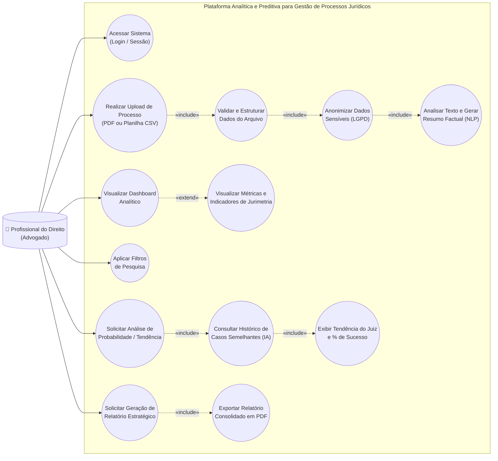
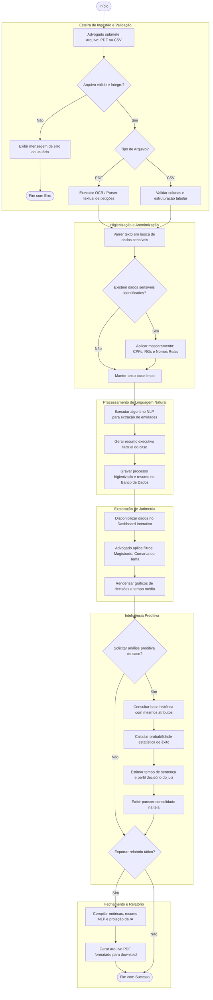
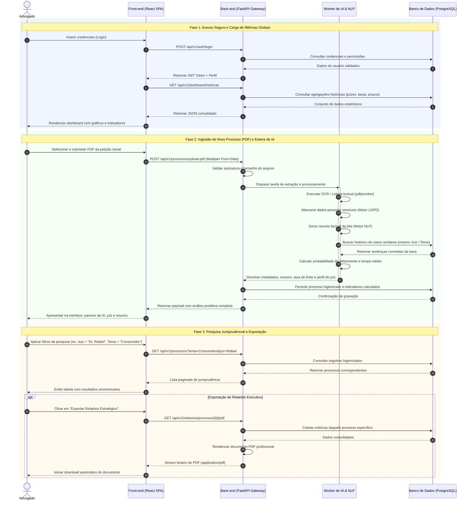
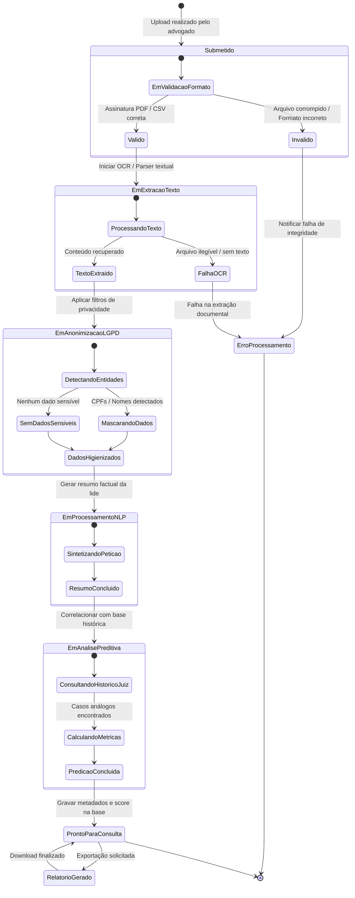

# Modelagem Comportamental e Dinâmica do Sistema

> **Projeto Avaliativo de Gerência de Projetos — Prof. Rafael De Amorim (UFAL)**  
> **Sistema:** Plataforma Analítica e Preditiva para Gestão de Processos Jurídicos (Equipe Epsilon)  
> **Finalidade:** Servir como especificação comportamental formal para desenvolvedores e agentes de codificação (Google Antigravity / Cursor).

---

## 1. Visão Geral da Modelagem Dinâmica

Enquanto o `ARCHITECTURE.md` estabelece a organização estática (componentes, contêineres e contratos de API), este documento especifica o **comportamento dinâmico e o ciclo de vida dos dados** na plataforma.

Os quatro diagramas fundamentais contemplam:
1. **Diagrama de Casos de Uso (DCU):** Delimitação do escopo funcional sob a ótica do usuário final (Advogado).
2. **Diagrama de Atividades (DA):** O fluxo operacional detalhado das esteiras de negócio e bifurcações de decisão.
3. **Diagrama de Sequência (DS):** A coreografia cronológica de mensagens e chamadas entre Front-end, Back-end API, Worker de IA e Persistência.
4. **Diagrama de Estados (DE):** Os estados transitórios que um processo jurídico assume desde o upload até a consolidação analítica e predição.

---

## 2. Diagrama de Casos de Uso (DCU)

### 2.1 Descrição do Escopo Funcional
O sistema possui como ator primário o **Profissional do Direito (Advogado)**. O modelo reflete a ingestão primária por PDF (com suporte a CSV em lote), as etapas obrigatórias de processamento interno (`<<include>>`), as funções estendidas condicionais (`<<extend>>`) e os módulos consultivos e preditivos.

### 2.2 Diagrama Mermaid

---

## 3. Diagrama de Atividades (DA)

### 3.1 Fluxo de Negócio Operacional
Mapeia a execução de ponta a ponta: desde a recepção do arquivo, passagem obrigatória pela esteira de segurança LGPD, indexação para consulta, cálculo preditivo sob demanda e geração de relatórios.

### 3.2 Diagrama Mermaid

---

## 4. Diagrama de Sequência (DS)

### 4.1 Ciclo Completo de Comunicação
O Diagrama de Sequência detalha as requisições assíncronas e síncronas entre os 5 atores e subsistemas definidos na arquitetura.

### 4.2 Diagrama Mermaid

---

## 5. Diagrama de Estados do Processo (DE)

### 5.1 Ciclo de Vida da Entidade Processual
Modela as transições de estado que um documento processual percorre no backend desde sua chegada bruta até a prontidão para consultas preditivas.

### 5.2 Diagrama Mermaid

---

## 6. Diretrizes para Agentes de Código (Google Antigravity)

Ao implementar rotas, serviços ou workers baseando-se neste documento:
1. **Nunca violar a sequência LGPD:** Qualquer rotina de sumarização (`MotorNLP`) ou de predição deve receber obrigatoriamente como entrada o texto que já transicionou pelo estado `DadosHigienizados`.
2. **Respeitar os Estados de Erro:** Em caso de exceção de leitura ou arquivo corrompido, a API deve atualizar o estado da entidade no banco para `ErroProcessamento` e retornar o código HTTP padronizado (422 Unprocessable Entity ou 400 Bad Request) com mensagem orientativa.
3. **Assincronismo nas Tarefas Longas:** Operações de OCR e predição não devem bloquear o loop principal da API FastAPI; devem ser delegadas a workers ou tarefas em background (`BackgroundTasks` / Celery / Redis).