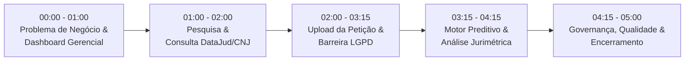

# Roteiro Oficial de Demonstração e Apresentação do JuriVision (Pitch de 5 Minutos)

**Disciplina:** Gerência de Projetos — Instituto de Computação, UFAL  
**Professor Avaliador:** Rafael De Amorim Silva  
**Equipe Responsável:** Equipe Epsilon (8 integrantes)  
**Data da Apresentação:** 10/11/2026 | **Tempo Alvo:** 5 minutos cronometrados

---

## 1. Checklist de Pré-Apresentação (10 Minutos Antes)

Antes de conectar ao projetor ou iniciar o compartilhamento de tela:
- [ ] **Ambiente Limpo:** Fechar navegadores com abas pessoais e notificações do WhatsApp/Telegram.
- [ ] **Resolução de Tela:** Ajustar para 1920x1080 (100% de escala) para nitidez dos gráficos e tabelas.
- [ ] **Inicialização em 1 Clique:**
  - Clicar duas vezes no arquivo [`start_dev.bat`](file:///c:/Users/g4bri/Documents/Workspaces/VSCode%20Workspace/JuriVision/start_dev.bat) (ou executar `./start_dev.ps1` no terminal).
  - Confirmar que as duas janelas abriram: Backend na porta `8000` e Frontend na porta `5173`.
- [ ] **Navegador Aberto:** Acessar [`http://localhost:5173`](http://localhost:5173).
- [ ] **Aba Secundária de Segurança:** Deixar aberta a documentação do Swagger em [`http://localhost:8000/docs`](http://localhost:8000/docs) caso o professor pergunte sobre os endpoints REST.
- [ ] **Aba Terciária do GitHub:** Deixar aberta a página da branch [`feat/sprint1-integracao-dev`](https://github.com/g4brielsiq/JuriVision/tree/feat/sprint1-integracao-dev) para evidenciar a governança e o histórico de commits.

---

## 2. Cronograma Minuto a Minuto da Apresentação

---

### [Minuto 00:00 - 01:00] Abertura, Problema de Negócio e Dashboard Gerencial
- **Apresentador(a):** Membro de Gerência / Requisitos (ex.: Daniel Filipe ou Fernando Gabriel).
- **Tela Exibida:** Aba **"Análise Jurimétrica"** (`#panel-dashboard`) com os gráficos de pizza e barras.
- **Roteiro de Fala:**
  > *"Bom dia professor Rafael e colegas. Nós somos a Equipe Epsilon e hoje apresentamos o **JuriVision**, a plataforma de jurimetria preditiva e pesquisa de precedentes para a advocacia alagoana.*
  > 
  > *O problema que resolvemos: advogados tomam decisões estratégicas no escuro, baseadas na intuição, sem saber a probabilidade real de êxito de suas causas ou o tempo de tramitação nas varas do TJAL. Além disso, ferramentas convencionais custam milhares de reais ou expõem dados sensíveis de clientes a IAs externas sem conformidade com a LGPD.*
  > 
  > *Como podemos ver nesta primeira tela, o JuriVision consolida em tempo real o histórico do acervo: taxa média de deferimento, tempo mediano de sentença em meses e distribuição estatística de decisões por magistrado e por matéria, transformando jurisprudência dispersa em evidência empírica."*

---

### [Minuto 01:00 - 02:00] Pesquisa de Precedentes e Integração Híbrida com o DataJud (CNJ)
- **Apresentador(a):** Membro de Dados / Front-end (ex.: Pedro Henrique ou Lucas Gabriel).
- **Ação na Tela:** Clicar na aba lateral **"Pesquisar Jurisprudência"** (`#panel-historico`).
- **Ação Prática:**
  1. Digitar na barra de busca o número CNJ de teste: `0710802-55.2018.8.02.0001` (ou clicar em um dos filtros rápidos de *Dano Moral*).
  2. Clicar no botão **"Consultar DataJud (CNJ)"**.
  3. Apontar para o cartão dourado que surge na tela com os metadados oficiais do CNJ e últimas movimentações.
- **Roteiro de Fala:**
  > *"O advogado pode pesquisar por tema, juiz ou número CNJ. Mas o diferencial do JuriVision é a nossa **integração híbrida com a API Pública do DataJud do Conselho Nacional de Justiça**.*
  > 
  > *Ao acionar a consulta oficial, nosso backend se comunica via query Elasticsearch DSL com o cluster do CNJ. Ele identifica automaticamente que o segmento 8.02 pertence ao TJAL, extrai classe processual, assunto tabelado pela TPU e histórico de movimentações.*
  > 
  > *E o mais importante do ponto de vista de Engenharia de Software: o sistema possui **tolerância a falhas (RNF-05)**. Se a API do CNJ demorar mais de 3 segundos ou estiver fora do ar, o backend aciona instantaneamente o fallback para a base local do TJAL, garantindo que o advogado nunca fique sem resposta."*

---

### [Minuto 02:00 - 03:15] Ingestão Documental e a Barreira Inviolável da LGPD
- **Apresentador(a):** Membro de Back-end / Arquitetura (ex.: Gabriel Damião ou Victor Samyr).
- **Ação na Tela:** Clicar na aba lateral **"Confronto com Precedentes"** (`#panel-upload`).
- **Ação Prática:**
  1. Mostrar a caixa de submissão.
  2. Clicar no botão de teste: **"Testar com petição demonstrativa (Atraso de Voo)"**.
  3. Aguardar o processamento (< 200ms) e mostrar a tela de resultado gerada.
- **Roteiro de Fala:**
  > *"Aqui está o coração inovador da plataforma: a **análise comparativa de petições com garantia de conformidade LGPD (Art. 12 da Lei 13.709)**.*
  > 
  > *O advogado submete uma petição inicial em PDF. O nosso pipeline executa a extração em memória e submete o texto ao `AnonimizadorLGPD`. Todos os nomes de pessoas físicas, CPFs e contatos são convertidos localmente em marcadores canônicos antes de qualquer armazenamento ou envio.*
  > 
  > *Observem na tela: o sistema exibe o selo auditável com a quantidade exata de CPFs e nomes ocultados, associado a um hash criptográfico HMAC-SHA256. Nenhum dado pessoal do cliente sai desprotegido."*

---

### [Minuto 03:15 - 04:15] Jurimetria Preditiva e o Parecer da Tese (Gemini AI + Estatística)
- **Apresentador(a):** Membro de Dados / Inteligência Artificial (ex.: Ygor Vasconcelos ou Emanuele Vitória).
- **Ação na Tela:** Descer a barra de rolagem no resultado da análise comparativa, destacando os 4 indicadores numéricos e a tese recomendada.
- **Roteiro de Fala:**
  > *"A partir da petição higienizada, nosso motor analítico opera em duas camadas:*
  > 
  > *1. **Camada Estatística Local Determinística (ADR-002):** Cruza a matéria com o acervo da vara do TJAL e calcula a probabilidade matemática de procedência (75%), o intervalo de confiança e a estimativa de tempo até a sentença.*
  > 
  > *2. **Camada Qualitativa (Google Gemini AI Studio):** O texto já anonimizado é interpretado pelo modelo Gemini 2.5 Flash na cota gratuita de desenvolvedor. A IA resume os fatos e identifica os pontos fortes da tese à luz do CDC e das súmulas do STJ aplicáveis em Alagoas.*
  > 
  > *O resultado é um dossiê executivo completo que o advogado pode exportar em PDF com um clique para apresentar ao seu cliente."*

---

### [Minuto 04:15 - 05:00] Governança, Qualidade e Encerramento
- **Apresentador(a):** Líder Técnico / Gerente do Projeto (ex.: Gabriel Damião ou Victor Samyr).
- **Ação na Tela:** Se houver tempo, alternar rapidamente para o terminal ou Swagger, ou encerrar na tela de resultados.
- **Roteiro de Fala:**
  > *"Para viabilizar este MVP sem custos reais (R$ 0,00), adotamos decisões arquiteturais rigorosas:*
  > - *Banco dual relacional (PostgreSQL assíncrono com contingência automática em SQLite);*
  > - *Monorepo modular testado sob normas ISO 29119 e WCAG 2.2 AA com **17 testes automatizados passando com 100% de sucesso**;*
  > - *Rastreabilidade de equipe com controle de branches no Git e registros individuais para cada um dos 8 integrantes.*
  > 
  > *O JuriVision está pronto, funcional e pronto para uso. Estamos à disposição para as perguntas da banca. Muito obrigado!"*

---

## 3. Perguntas Mais Prováveis da Banca e Respostas Blindadas

| Pergunta Provável do Professor | Resposta Recomendada da Equipe |
| :--- | :--- |
| **"Vocês gastaram algum dinheiro real com banco de dados ou API da OpenAI?"** | *"Não professor. Cumprimos rigorosamente a diretriz de **custo real zero (R$ 0,00)**. Utilizamos PostgreSQL/SQLite locais, a API Pública e gratuita do DataJud (CNJ) e a cota gratuita para desenvolvedores do Google AI Studio (Gemini 2.5 Flash), que não exige faturamento."* |
| **"E se a internet cair durante a demonstração, o sistema quebra?"** | *"Não quebra. Adotamos o padrão arquitetural Strategy/Adapter ([ADR-002](file:///c:/Users/g4bri/Documents/Workspaces/VSCode%20Workspace/JuriVision/docs/decisions/ADR-002-ia-local-deterministica-vs-api-externa.md)). Se a internet cair, o sistema detecta o timeout em 3 segundos e aciona automaticamente o nosso motor heurístico e o acervo local homologado do TJAL."* |
| **"A API do DataJud disponibiliza o PDF da petição inteira?"** | *"Não. Conforme documentado pelo CNJ, o DataJud fornece exclusivamente metadados processuais estruturados e movimentações. Por isso, a nossa arquitetura é híbrida: o DataJud valida o histórico oficial do tribunal, e a nossa barreira de ingestão local processa a petição enviada pelo advogado."* |
| **"Como vocês garantem que a IA não infringe a LGPD?"** | *"Seguimos o Artigo 12 da LGPD (dados anonimizados não são considerados dados pessoais). A nossa classe `AnonimizadorLGPD` processa o texto no backend localmente antes de qualquer chamada externa. Nomes de pessoas físicas viram marcadores canônicos e CPFs são substituídos por tokens, registrando hash HMAC-SHA256 auditável."* |
| **"Por que usar monorepo em vez de microsserviços separados em repositórios diferentes?"** | *"Para um MVP acadêmico de 8 integrantes com prazo exíguo, o monorepo modular garante atomicidade nos commits, evita desalinhamento de contratos de API e permite que suítes de teste de integração (como os nossos 17 testes de backend e front) rodem em menos de 6 segundos com um único comando."* |
