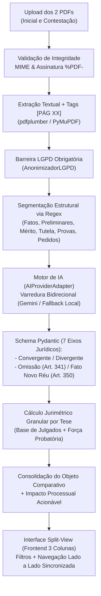

# Plano de Implementação: Visualizador Comparativo de Peças Jurídicas (Petição Inicial vs. Contestação)

> **Projeto JuriVision** — Plataforma de Pesquisa Jurisprudencial e Jurimetria  
> **Módulo:** Visualizador Comparativo de Peças Processuais (Saneamento, Convergências, Divergências e Probabilidade de Procedência)  
> **Status:** Documentação de Planejamento e Especificação Prévia de Engenharia (Revisado)

---

## 1. Visão Geral e Objetivo

O objetivo deste módulo é permitir que advogados e equipes jurídicas realizem o upload simultâneo de duas peças fundamentais de um processo (**Petição Inicial** e **Contestação**) para realizar uma análise completa de saneamento processual (art. 357 do CPC) e preparação de réplica:

1. **Identificar automaticamente os pontos controvertidos e incontroversos** ao longo de **7 eixos jurídicos** (Preliminares, Prejudiciais de Mérito, Fatos/Cronologia/Valores, Mérito, Tutelas Provisórias, Provas/Ônus e Pedidos Finais).
2. **Classificar cada ponto confrontado** em:
   * **Convergente (`convergente`):** Ambas as partes concordam expressamente;
   * **Divergente (`divergente`):** O réu impugnou especificamente a alegação, data, valor ou pedido do autor;
   * **Incontroverso por Omissão (`fato_incontroverso_por_omissao`):** O réu não impugnou especificamente o argumento ou pedido do autor (art. 341 do CPC, desconsiderando negativa geral);
   * **Fato Novo / Extintivo da Defesa (`fato_novo_ou_extintivo_reu`):** O réu alegou fato impeditivo, modificativo ou extintivo inédito (art. 350 do CPC, ex.: pagamento, compensação, culpa de terceiro) sem correspondência prévia na inicial.
3. **Gerar orientação processual acionável (`impacto_processual`)** e calcular a **probabilidade de procedência** de cada tese, integrando análise da força probatória com a base histórica de precedentes judiciais (jurimetria com lastro empírico).
4. **Exibir a comparação em uma interface visual lado a lado (*Split-View*)**, sincronizada e com filtros por eixo jurídico e status.

---

## 2. Stack Tecnológica Selecionada

A escolha das tecnologias alinha as necessidades jurídicas do estudo de caso com a arquitetura já estabelecida no repositório JuriVision:

| Camada | Tecnologia | Justificativa Técnica no JuriVision |
| :--- | :--- | :--- |
| **Parsing e Extração de PDF** | `pdfplumber` + `PyMuPDF` (`fitz`) | `pdfplumber` já está instalado e ativo no backend do JuriVision. Permite extração página a página com injeção de marcadores `[PÁG XX]`, segmentação por seções e coordenadas $(x, y)$ para mapear trechos com exatidão. |
| **Privacidade & LGPD** | `AnonimizadorLGPD` (Motor interno em Regex + Hash SHA-256) | Invariante inegociável do projeto (`RN-01`). Higieniza CPFs, RGs e nomes de pessoas físicas **antes** do envio a qualquer LLM ou banco de dados, preservando datas, valores monetários e normas legais. |
| **Núcleo de IA e NLP** | **Google Gemini API** (Gemini 2.5 Flash / Pro) via `AIProviderAdapter` | Janela de contexto longa ideal para varredura bidirecional (Autor $\rightarrow$ Réu e Réu $\rightarrow$ Autor) em uma única chamada. O modo local (`AI_PROVIDER=local`) permanece como fallback determinístico para custo zero e testes offline. |
| **Tipagem e Contrato Estruturado** | `Pydantic v2` (*Structured Outputs*) | Garante que a IA retorne um JSON rígido e validado (`response_schema`), utilizando `Field(description=...)` para orientar a classificação jurídica e citações literais. |
| **Backend & API Gateway** | **Python 3.11+ / FastAPI** | Framework oficial do projeto: rápido, tipado, assíncrono e integrado à documentação OpenAPI / Swagger (`/docs`). |
| **Orquestração Assíncrona** | FastAPI `BackgroundTasks` + Server-Sent Events (SSE) / Polling estruturado | Permite acompanhar o processamento de 15 a 30 segundos das peças sem inflar a arquitetura com serviços externos pesados (conforme `ADR-001`). |
| **Motor de Jurimetria** | Algoritmo Híbrido JuriVision (`SQLAlchemy 2.0` + Base de Decisões) | Cruza o `tema` da tese divergente com as decisões do magistrado/tema já persistidas no banco (`PostgreSQL` / `SQLite`), ponderando taxa histórica e tipo de prova apresentada. |
| **Frontend Web** | **HTML5 Semântico + Vanilla ES Modules + CSS Design Tokens** (*Legal Editorial*) | Segue a arquitetura leve e acessível já padronizada no JuriVision (**W3C WCAG 2.2 Nível AA**), evitando overhead de build desnecessário. |
| **Visualização Split-View** | Componente Customizado de 3 Colunas Sincronizadas (com `scrollIntoView` e *highlights*) | Permite navegar pelos textos em paralelo, filtrando por eixo jurídico/status e destacando trechos literais com códigos de cores semânticos. |

---

## 3. Arquitetura do Fluxo de Dados (Pipeline)



---

## 4. Estrutura de Dados Contratada (Schemas Pydantic)

O contrato de dados (`backend/app/schemas/comparacao.py`) garante que tanto a IA quanto a interface trabalhem com cobertura jurídica completa para saneamento e réplica:

```python
from datetime import datetime
from enum import Enum
from typing import List, Optional
from pydantic import BaseModel, Field

class StatusTese(str, Enum):
    CONVERGENTE = "convergente"
    DIVERGENTE = "divergente"
    INCONTROVERSO_POR_OMISSAO = "fato_incontroverso_por_omissao"
    FATO_NOVO_DEFESA = "fato_novo_ou_extintivo_reu"

class TipoTese(str, Enum):
    PRELIMINAR = "preliminar"
    PREJUDICIAL_MERITO = "prejudicial_merito"
    FATO_CRONOLOGIA = "fato_ou_valor"
    MERITO = "merito"
    TUTELA_PROVISORIA = "tutela_provisoria"
    PROVA_ONUS = "prova_e_onus"
    PEDIDO = "pedido_e_valor_causa"

class PontoControvertido(BaseModel):
    id_tese: str = Field(
        description="Identificador único sequencial, ex: 'TESE-01'."
    )
    tipo: TipoTese = Field(
        description="Categoria jurídica estrita entre os 7 eixos de análise processual."
    )
    tema: str = Field(
        description="Título curto e objetivo (ex: 'Data do Inadimplemento', 'Inversão do Ônus da Prova', 'Prescrição Trienal')."
    )
    trecho_autor: Optional[str] = Field(
        default=None,
        description="Citação literal exata extraída da Petição Inicial (sem alterar palavras). Deve ser null apenas se status='fato_novo_ou_extintivo_reu'."
    )
    trecho_reu: Optional[str] = Field(
        default=None,
        description="Citação literal exata extraída da Contestação. Deve ser null apenas se status='fato_incontroverso_por_omissao'."
    )
    status: StatusTese = Field(
        description="Classificação do confronto conforme arts. 341 e 350 do CPC."
    )
    forca_probatoria_autor: str = Field(
        description="Avaliação objetiva do lastro probatório do autor neste ponto (ex: 'Documental Robusta - Contrato Assinado')."
    )
    forca_probatoria_reu: str = Field(
        description="Avaliação objetiva do lastro probatório do réu neste ponto (ex: 'Mera Alegação Retórica' ou 'Não Impugnado')."
    )
    probabilidade_procedencia_pct: float = Field(
        ge=0.0,
        le=100.0,
        description="Estimativa percentual de êxito do autor neste ponto."
    )
    fundamentacao_preditiva: str = Field(
        description="Justificativa técnica cruzando provas apresentadas, norma aplicável e histórico jurimétrico."
    )
    impacto_processual: str = Field(
        description="Orientação prática acionável em 1 frase para o advogado (ex: 'Requerer reconhecimento de fato incontroverso em réplica')."
    )
    pagina_autor: Optional[int] = Field(
        default=None,
        description="Número inteiro da página extraído da tag [PÁG XX] da Petição Inicial."
    )
    pagina_reu: Optional[int] = Field(
        default=None,
        description="Número inteiro da página extraído da tag [PÁG XX] da Contestação."
    )

class ResultadoComparacaoPecas(BaseModel):
    id_comparacao: str
    numero_processo: Optional[str] = None
    resumo_controvertido_geral: str = Field(
        description="Síntese executiva do litígio, principais pontos controvertidos e riscos processuais."
    )
    total_teses: int
    total_convergencias: int
    total_divergencias: int
    total_omissoes: int
    total_fatos_novos_defesa: int
    score_geral_favorabilidade_autor_pct: float
    teses: List[PontoControvertido]
    criado_em: datetime
```

---

## 5. Roteiro de Execução Passo a Passo (Fases)

Para garantir qualidade, estabilidade e conformidade com os testes automatizados, o desenvolvimento segue **4 etapas incrementais**:

### 🔹 Etapa 1: Backend, Pré-processador & Contratos de Dados (Fundação)
* Criar os schemas Pydantic atualizados em `backend/app/schemas/comparacao.py`.
* Implementar o pré-processador de PDF (`pdfplumber`/`PyMuPDF`) com injeção de marcadores `[PÁG XX]` e segmentação por macro-seções (`Fatos`, `Preliminares`, `Mérito`, `Tutela`, `Provas`, `Pedidos`).
* Criar o router `POST /api/v1/processos/comparar-pecas` aceitando dois uploads `multipart/form-data` (`peticao_inicial` e `contestacao`) com validação MIME e assinatura `%PDF-`.
* Integrar com o `AnonimizadorLGPD` para sanitização imediata de ambas as peças.
* Desenvolver testes automatizados em `pytest` cobrindo validações de entrada, erros `422` e resposta com mock estruturado.

### 🔹 Etapa 2: Motor de Extração Bidirecional e Confronto (IA / NLP)
* Estender o `AIProviderAdapter` com o método `comparar_pecas(texto_inicial, texto_contestacao)`.
* Configurar o prompt estruturado (*Juiz Saneador - art. 357 CPC*) com saída JSON obrigatória (`response_schema=ResultadoComparacaoPecas`), executando:
  * **Varredura Direta (Autor $\rightarrow$ Réu):** Identifica convergências, divergências e omissões de impugnação específica (ignorando negativa geral) nos 7 eixos jurídicos.
  * **Varredura Reversa (Réu $\rightarrow$ Autor):** Captura fatos impeditivos, modificativos ou extintivos inéditos trazidos pela defesa (`fato_novo_ou_extintivo_reu`).
* Implementar o fallback local determinístico (`AI_PROVIDER=local`) baseado em Regex (datas `\d{2}/\d{2}/\d{4}`, valores monetários `R\$`, preliminares, prescrição, ônus da prova e pedidos) para execução 100% offline nos testes da suíte `pytest`.

### 🔹 Etapa 3: Motor de Probabilidade de Procedência por Argumento
* Adaptar o cálculo da jurimetria (`RN-02`) para operar em nível granular:
  * Cruzar o `tema` e o `tipo` de cada ponto divergente com as decisões do juiz/tribunal armazenadas no banco.
  * Ponderar o peso probatório (`forca_probatoria_autor` vs. `forca_probatoria_reu`) e o status processual (ex.: presunção de veracidade em omissões) para gerar a estimativa percentual e preencher `impacto_processual`.

### 🔹 Etapa 4: Interface de Comparação Lado a Lado (Frontend Split-View)
* Criar a nova visualização/aba na SPA: **"Comparador de Peças"**.
* Modal de upload duplo com drag-and-drop para Petição Inicial e Contestação.
* Painel de visualização lado a lado (*Split-View*) em **3 colunas sincronizadas**:
  * **Coluna Esquerda:** Petição Inicial higienizada com navegação por página e *highlights*.
  * **Coluna Central:** Feed interativo de `PontoControvertido` com filtros por **Eixo Jurídico (`TipoTese`)** e **Status (`StatusTese`)**, badges coloridos (verde para convergente, vermelho para divergente, âmbar para omissão, roxo/azul para fato novo da defesa), percentual de êxito e alerta de `impacto_processual`.
  * **Coluna Direita:** Contestação higienizada com navegação por página e *highlights*.
* Ao clicar em um card central, ambas as colunas laterais rolam suavemente (`scrollIntoView`) até os respectivos trechos literais confrontados (`trecho_autor` e `trecho_reu`).
* Acessibilidade completa (**W3C WCAG 2.2 Nível AA**) com navegação por teclado e rótulos semânticos.

---

## 6. Governança e Salvaguardas do Projeto

1. **Custo Zero:** A chamada externa de LLM utilizará a camada gratuita da Google Gemini API (ou o motor local determinístico do JuriVision), garantindo aderência à diretriz orçamentária do projeto UFAL.
2. **Segurança e LGPD:** Nenhuma palavra de documento sem anonimização prévia chegará à camada de processamento de linguagem natural ou persistência.
3. **Não-Regressão:** A suíte existente de 11 testes automatizados continuará 100% verde durante e após todas as alterações.