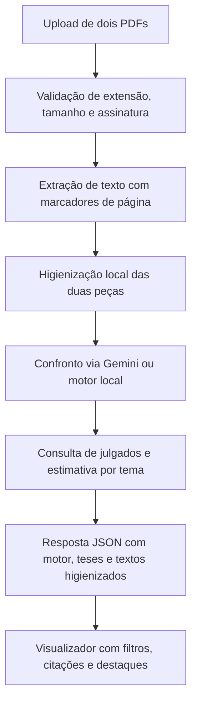

# Plano de Implementação — Visualizador Comparativo de Peças Jurídicas (Petição Inicial vs. Contestação)

> **Projeto JuriVision** · **Branch** `Comparador/Ygor`
>
> **Estado implementado** em 23/11/2026, com base no código do comparador em `fd9ddca`.

## 1. Visão geral e objetivo

O **Comparador de Peças** recebe uma petição inicial e uma contestação em PDF. A interface exibe os textos higienizados, as teses identificadas automaticamente e as citações disponíveis para apoiar a conferência dos pontos controvertidos e a preparação da réplica. O contrato contempla sete eixos jurídicos e quatro classificações. Cada tese inclui uma orientação processual e, quando há histórico suficiente para seu tema, uma estimativa de procedência.

## 2. Stack tecnológica

| Camada | Implementação |
| --- | --- |
| Extração de PDF | `pypdf` (`PdfReader`) extrai texto por página e insere marcadores `[PÁG XX]`. A rota depende de texto extraível. PDFs sem texto legível retornam erro. |
| Higienização | `AnonimizadorLGPD` mascara CPFs, RGs identificados por rótulo e nomes reconhecidos por padrões contextuais. |
| Comparação | `AIGatewayPort` define a interface. `ResilientAIGateway` seleciona `GeminiAIAdapter` ou `LocalDeterministicFallbackAdapter`. |
| Contratos | Pydantic v2 valida a resposta estruturada do Gemini e define a resposta pública da API. |
| API e jurimetria | FastAPI recebe os PDFs em uma requisição multipart. SQLAlchemy consulta os julgados elegíveis. A resposta da própria requisição contém a comparação concluída. |
| Interface | HTML, JavaScript em módulos e CSS com tokens de design. O frontend usa `fetch` e exibe uma mensagem enquanto aguarda a API. |

## 3. Arquitetura do fluxo de dados

## 4. Contrato de dados

| Modelo | Campos e finalidade |
| --- | --- |
| `TeseExtraida` | `tipo`, `tema`, `status`, `trecho_autor`, `trecho_reu`, `pagina_autor`, `pagina_reu`, `forca_probatoria_autor`, `forca_probatoria_reu` e `impacto_processual`. As duas citações e suas páginas aceitam `null` quando indisponíveis. |
| `RespostaComparacaoGemini` | `resumo_controvertido_geral` e `teses` do tipo `TeseExtraida`. É o modelo usado para solicitar e validar a saída estruturada. |
| `PontoControvertido` | Estende `TeseExtraida` com `id_tese`, `probabilidade_procedencia_pct` e `fundamentacao_preditiva`. A fundamentação informa a base da estimativa ou o motivo da indisponibilidade. |
| `ResultadoComparacaoPecas` | `id_comparacao`, `numero_processo` (quando identificado), `resumo_controvertido_geral`, `total_teses`, `total_convergencias`, `total_divergencias`, `total_omissoes`, `total_fatos_novos_defesa`, `score_geral_favorabilidade_autor_pct`, `motor_analise` (`gemini` ou `local`), `teses`, `texto_higienizado_autor`, `texto_higienizado_reu` e `criado_em`. Os textos incluem os marcadores de página usados pelo visualizador. |

Os eixos de `TipoTese` são `preliminar`, `prejudicial_merito`, `fato_ou_valor`, `merito`, `tutela_provisoria`, `prova_e_onus` e `pedido_e_valor_causa`. Os valores de `StatusTese` são `convergente`, `divergente`, `fato_incontroverso_por_omissao` e `fato_novo_ou_extintivo_reu`. [Modelos Pydantic](../../../backend/app/schemas/comparacao.py)

## 5. Etapas da implementação

### Etapa 1 — Recebimento e preparação dos PDFs

A rota `POST /api/v1/processos/comparar-pecas` recebe os campos `peticao_inicial` e `contestacao` em `multipart/form-data`. A API aceita arquivos com extensão `.pdf`, assinatura `%PDF-` e até 15 MB por peça (15 × 1024² bytes). O excesso de tamanho retorna HTTP 413. Formato inválido, arquivo corrompido ou falha na extração de texto retornam HTTP 422.

O extrator devolve o texto de cada peça com marcadores de página. A rota higieniza os dois textos antes de encaminhá-los ao motor e consulta o banco para calcular a estimativa. A comparação é devolvida na resposta HTTP 200. [Rota](../../../backend/app/routers/processos.py) · [Extração e higienização](../../../backend/app/core/ai_gateway.py)

### Etapa 2 — Comparação das peças e seleção do motor

- **Gemini.** O gateway chama o modelo configurado em `GEMINI_MODEL` quando `AI_PROVIDER` é `gemini` ou `auto` e há chave configurada. O prompt recebe até os primeiros **5.000 caracteres higienizados de cada peça**. Pede o confronto da inicial com a contestação e a identificação de preliminares e fatos novos da defesa, com citações e páginas quando disponíveis. O adaptador envia a chave em `x-goog-api-key` e solicita JSON via `responseJsonSchema`. Após validar a resposta, o backend monta os identificadores e as contagens e registra `motor_analise=gemini`.
- **Análise local.** É o modo padrão e atende solicitações sem chave. Também assume quando o Gemini apresenta erro HTTP, timeout ou resposta vazia ou inválida. As regras determinísticas usam datas, valores e palavras-chave para classificar teses e localizar trechos no texto. Quando esse motor responde, a API registra `motor_analise=local`.

Os sete eixos e quatro status são opções do contrato. A cobertura depende do texto e das regras do motor. No modo local, uma data coincidente ou uma palavra de impugnação fora do contexto pode levar a uma classificação incorreta. A classificação, a força probatória e a orientação retornadas servem como indicações para conferência das peças. [Gateway de análise](../../../backend/app/core/ai_gateway.py) · [Configuração](../../../backend/app/core/config.py)

### Etapa 3 — Estimativa de procedência por tema

1. O backend aplica a mesma regra aos resultados dos dois motores. Compara o tema de cada tese com o tema dos julgados após normalizar maiúsculas, minúsculas e espaços.
2. A amostra considera processos de origem manual com desfecho **Procedente** ou **Improcedente** e exclui o próprio processo comparado quando identificado.
3. Com menos de **cinco julgados do mesmo tema**, a API retorna `null` em `probabilidade_procedencia_pct` e informa o tamanho da amostra em `fundamentacao_preditiva`.
4. Com histórico suficiente, calcula `100 × (julgados procedentes + 1) / (total de julgados + 2)`, com suavização de Laplace e arredondamento para uma casa decimal. O percentual é uma referência histórica do tema. A classificação da tese e a força probatória exibida no contrato ficam fora do cálculo.
5. A média geral em `score_geral_favorabilidade_autor_pct` fica disponível quando existe pelo menos uma tese e todas têm estimativa. Nos demais casos, o campo retorna `null`. [Cálculo da estimativa](../../../backend/app/routers/processos.py)

### Etapa 4 — Interface de comparação lado a lado

- A aba **Comparador de Peças** permite escolher ou arrastar cada PDF. O resultado mostra a petição inicial, a lista de teses e a contestação em três colunas em telas largas. O layout passa a uma coluna quando a largura é de até 1.200 px.
- Cada tese mostra tema, eixo, status, páginas citadas, estimativa com fundamentação e orientação processual. Se o valor é `null`, exibe **Estimativa indisponível**. O resumo também mostra a média, quando disponível, e o rótulo **Gemini** ou **Análise local**.
- A seleção por clique, Enter ou Espaço busca a citação completa, tolera quebras de linha e prioriza a página indicada. Cada painel destaca apenas a passagem localizada e rola até ela com `scrollTo`, respeitando a preferência de movimento reduzido. Uma citação ausente ou sem correspondência deixa o painel sem destaque.
- Os filtros de eixo e status podem ser combinados. A tela informa o total visível, limpa os destaques quando a combinação fica sem resultados e reinicia os filtros ao exibir uma nova comparação. [Interface](../../../frontend/src/app.js) · [Layout](../../../frontend/src/components/design-tokens.css)

#### Demonstração guiada

Os casos fictícios **Atraso de voo e despesas de hospedagem** e **Cobrança após cancelamento de assinatura** geram uma petição inicial e uma contestação de três páginas cada. A interface envia esses PDFs para a mesma rota das peças próprias e apresenta o guia de leitura do caso, o CNJ fictício e os controles de teses do comparador. [Casos demonstrativos](../../../frontend/src/components/comparador-demo.js)

## 6. Evidências de validação

A suíte do comparador cobre os PDFs aceitos, arquivos inválidos e acima do limite, marcadores de página, higienização em ambas as peças, contrato de resposta, comparação local, seleção do motor, fallback simulado e cálculo da estimativa. O diário de bordo registra 46 testes aprovados, build de produção aprovado e a validação dos dois exemplos no Chrome com o motor local, incluindo seleção por teclado e filtros. Também registra um teste com resposta válida do Gemini usando PDFs fictícios. [Testes do comparador](../../../backend/tests/test_comparador_pecas.py) · [Diário de bordo](./CHANGELOG.md)

O histórico das tentativas, incluindo a comparação local por trechos que foi revertida, está no [registro de ajustes](./registro_ajustes_comparador.md).
