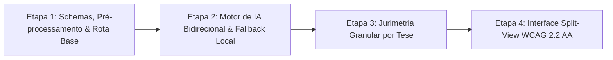

# Plano Técnico de Implementação: Visualizador Comparativo de Peças Jurídicas
> **Projeto JuriVision** — Plataforma de Pesquisa Jurisprudencial e Jurimetria  
> **Membro Responsável:** Ygor Vasconcelos  
> **Documento Base:** `docs/membros/ygor-vasconcelos/plano_de_implementa_o_visualizador_comparativo_de_pe_as_jur_dicas.md`  
> **Branch Alvo:** `Comparador/Ygor` (a ser criada após aprovação)  
> **Status:** Aguardando Aprovação do Usuário

---

## 1. Diagnóstico da Inspeção da Base Existente

A inspeção detalhada do repositório confirmou a conformidade com as diretrizes de arquitetura:

| Componente | Localização Atual | Padrão / Convenção Identificada | Diretriz de Integração |
| :--- | :--- | :--- | :--- |
| **Barreira LGPD (`RN-01`)** | `backend/app/core/ai_gateway.py` (`AnonimizadorLGPD`) | Regex determinístico auditável para CPF, RG e nomes de pessoas físicas; preserva PJ, datas, valores e normas legais. | Nenhuma chamada de LLM ou persistência receberá texto sem prévia passagem pelo `AnonimizadorLGPD.sanitize_text`. |
| **Isolamento de IA (`ADR-002`)** | `backend/app/core/ai_gateway.py` (`AIGatewayPort`, `LocalDeterministicFallbackAdapter`, `GeminiAIAdapter`, `ResilientAIGateway`) | Port & Adapter estruturado com fallback determinístico local imediato se offline ou sem `GEMINI_API_KEY`. | Estender a interface do Gateway com `comparar_pecas` garantindo o mesmo padrão de fallback local para a suíte de testes. |
| **Rotas & Schemas** | `backend/app/routers/processos.py`, `backend/app/schemas/contracts.py` | FastAPI com injeção de dependência (`get_db`), Pydantic v2 com validações rigorosas e tratamento de erros padronizado (`422`, `413`). | Criar `backend/app/schemas/comparacao.py` e acoplar a rota `POST /api/v1/processos/comparar-pecas` no roteador oficial. |
| **Motor de Jurimetria (`RN-02`)** | `backend/app/routers/processos.py` (`_compute_historical_context`) | Consulta banco relacional (`Processo`, `AnalisePreditiva`) calculando taxa histórica do magistrado, prazo médio e volume. | Adaptar o cálculo para o nível granular por tese controvertida, ponderando a força probatória relativa. |
| **Estrutura Frontend** | `frontend/index.html`, `frontend/src/app.js`, `frontend/src/services/api.js`, `design-tokens.css` | HTML5 Semântico, Vanilla ES Modules, CSS Custom Properties (`--color-surface`, etc.), W3C WCAG 2.2 AA e navegação por teclado. | Adicionar nova aba "Comparador de Peças" (`comparador`) com visualizador *Split-View* de 3 colunas sincronizadas. |
| **Suíte de Testes** | `backend/tests/` (33 testes ativos, 11 em `test_api_contracts.py`) | Pytest com `TestClient(app)`, cobertura de requisitos e rastreabilidade com ISO 29119. | Preservar 100% verde nos 33 testes existentes e adicionar novos testes incrementais a cada etapa. |

---

## 2. Roteiro Técnico Detalhado por Etapas



---

### 🔹 Etapa 1: Backend, Pré-processador & Contratos de Dados (Fundação)
**Objetivo:** Estabelecer o contrato de dados formal (Pydantic v2), a extração de PDF com coordenadas de página `[PÁG XX]` e a rota multipart com barreira LGPD imediata.

#### Arquivos a Criar/Modificar:
1. **`backend/app/schemas/comparacao.py` (Novo):**
   - `StatusTese`: Enum (`convergente`, `divergente`, `fato_incontroverso_por_omissao`, `fato_novo_ou_extintivo_reu`).
   - `TipoTese`: Enum (`preliminar`, `prejudicial_merito`, `fato_ou_valor`, `merito`, `tutela_provisoria`, `prova_e_onus`, `pedido_e_valor_causa`).
   - `PontoControvertido`: Schema validando citações literais, páginas de origem (`pagina_autor`, `pagina_reu`), força probatória, percentual de êxito e orientação de `impacto_processual`.
   - `ResultadoComparacaoPecas`: Objeto raiz consolidado com totais, score geral e lista de teses.
2. **`backend/app/core/ai_gateway.py` (Modificação):**
   - Estender `ExtratorDocumental` com `extract_text_with_page_markers(file_bytes: bytes) -> tuple[str, dict[int, str]]`:
     - Utiliza `pdfplumber` / `pypdf` para extrair página a página injetando o marcador explícito `\n[PÁG {numero_pagina}]\n`.
     - Segmentação estrutural via Regex para detectar macro-seções jurídicas (Fatos, Preliminares, Mérito, Tutela, Provas, Pedidos).
3. **`backend/app/routers/processos.py` (Modificação):**
   - Adicionar endpoint `POST /api/v1/processos/comparar-pecas`:
     - Recebe `peticao_inicial: UploadFile` e `contestacao: UploadFile`.
     - Validação rigorosa: extensão `.pdf`, limite de 15MB (`MAX_PDF_SIZE_BYTES`) e assinatura binária `%PDF-`.
     - Extração dos textos com tags `[PÁG XX]`.
     - Higienização obrigatória de ambas as peças via `AnonimizadorLGPD.sanitize_text`.
     - Retorno inicial com mock estruturado no contrato `ResultadoComparacaoPecas`.
4. **`backend/tests/test_comparador_pecas.py` (Novo):**
   - Teste de validação de arquivos inválidos (HTTP 422).
   - Teste de payload superior a 15MB (HTTP 413).
   - Teste de barreira LGPD: garantia de que nenhum CPF ou nome transponha a rota para ambas as peças.
   - Validação do schema Pydantic retornado.

**Critério de Conclusão da Etapa 1:** `pytest backend/tests/test_comparador_pecas.py` e `pytest backend/tests/test_api_contracts.py` 100% verdes.

---

### 🔹 Etapa 2: Motor de Extração Bidirecional e Confronto (IA / NLP)
**Objetivo:** Implementar a inteligência do confronto de peças via Gemini API com prompt de saneador processual (art. 357 do CPC) e fallback determinístico offline.

#### Arquivos a Criar/Modificar:
1. **`backend/app/core/ai_gateway.py` (Modificação):**
   - Adicionar método abstrato `comparar_pecas(self, texto_inicial: str, texto_contestacao: str, contexto_historico) -> ResultadoComparacaoPecas` na interface `AIGatewayPort`.
   - Implementar no `GeminiAIAdapter`:
     - Prompt instrucional modelando o papel de *Juiz Saneador*:
       - **Varredura Direta (Autor $\rightarrow$ Réu):** Para cada alegação/pedido da inicial, checa se a contestação concorda expressamente (`convergente`), impugna expressamente (`divergente`) ou não impugna (`fato_incontroverso_por_omissao`, aplicando a preclusão do art. 341 do CPC).
       - **Varredura Reversa (Réu $\rightarrow$ Autor):** Identifica defesas indiretas inéditas (`fato_novo_ou_extintivo_reu`, art. 350 do CPC: prescrição, culpa de terceiro, exceção de contrato não cumprido, etc.).
       - Extração precisa dos números de página a partir das tags `[PÁG XX]`.
       - Structured Output garantido via `response_schema` com Pydantic v2.
   - Implementar no `LocalDeterministicFallbackAdapter`:
     - Algoritmo heurístico/regex determinístico (custo zero e 100% offline para os testes automatizados):
       - Varredura de datas (`\d{2}/\d{2}/\d{4}`), valores monetários (`R\$\s*[\d.,]+`), palavras-chave de preliminares, prescrição/decadência, tutelas e pedidos.
       - Geração determinística de pontos controvertidos com citações literais reais e números de página extraídos das tags.
   - Integrar chamada no `ResilientAIGateway`.
2. **`backend/app/routers/processos.py` (Modificação):**
   - Atualizar a rota `POST /api/v1/processos/comparar-pecas` para invocar `ai_gateway.comparar_pecas`.
3. **`backend/tests/test_comparador_pecas.py` (Modificação):**
   - Teste de confronto bidirecional completo via `AI_PROVIDER=local`.
   - Validação da presença dos 7 eixos jurídicos e dos 4 status de tese.
   - Validação da extração correta de `pagina_autor` e `pagina_reu`.

**Critério de Conclusão da Etapa 2:** Todos os testes do comparador rodando e passando 100% offline.

---

### 🔹 Etapa 3: Motor de Probabilidade de Procedência por Argumento (Jurimetria Granular)
**Objetivo:** Adaptar a regra de negócio `RN-02` para calcular probabilidade de êxito e impacto processual específico para cada ponto da controvérsia.

#### Arquivos a Criar/Modificar:
1. **`backend/app/routers/processos.py` ou serviço dedicado de jurimetria granular:**
   - Algoritmo que recebe cada `PontoControvertido`:
     - Consulta na base relacional decisões históricas correlatas ao `tema` e `tipo` da tese.
     - Ponderação com base no status processual:
       - Omissão do réu (art. 341 do CPC): elevação da probabilidade em favor do autor por presunção relativa de veracidade (ex.: 85% a 95%).
       - Fato novo do réu (art. 350 do CPC): ônus probatório atribuído à defesa; cálculo ponderado por prova documental acostada.
       - Divergência: balanceamento entre `forca_probatoria_autor` e `forca_probatoria_reu` calibrado pelo histórico do magistrado.
     - Geração de frase acionável para `impacto_processual` orientando a réplica do advogado.
     - Consolidação do `score_geral_favorabilidade_autor_pct`.
2. **`backend/tests/test_comparador_pecas.py` (Modificação):**
   - Teste de limites estatísticos: garantia de `0.0 <= probabilidade_procedencia_pct <= 100.0`.
   - Teste de coerência jurídica: pontos incontroversos por omissão devem apresentar maior favorabilidade que divergências com prova em contrário.

**Critério de Conclusão da Etapa 3:** Cálculos jurimétricos granulares validados matematicamente e juridicamente via testes automatizados.

---

### 🔹 Etapa 4: Interface de Comparação Lado a Lado (Frontend Split-View WCAG 2.2 AA)
**Objetivo:** Construir a interface visual de saneamento processual na SPA do JuriVision, garantindo design system *Legal Editorial*, responsividade, sincronização de rolagem e acessibilidade Nível AA.

#### Arquivos a Criar/Modificar:
1. **`frontend/index.html` (Modificação):**
   - Adicionar botão de navegação na barra lateral:
     - `id="btn-comparador"`, `role="tab"`, `aria-controls="panel-comparador"`.
   - Adicionar painel correspondente `panel-comparador`:
     - Área de upload duplo (drag-and-drop acessível) para Petição Inicial e Contestação, com botão de demonstração rápida (1 clique com peças de teste pré-construídas).
     - Componente *Split-View* de 3 colunas:
       - **Coluna Esquerda:** Visualizador da Petição Inicial (com seletor de página e marcação de trecho).
       - **Coluna Central:** Feed de Teses (`PontoControvertido`) com barra de filtros (chips por Eixo Jurídico e Status), barra de progresso do score global, badges semânticos e alertas de `impacto_processual`.
       - **Coluna Direita:** Visualizador da Contestação (com seletor de página e marcação de trecho).
2. **`frontend/src/components/design-tokens.css` (Modificação):**
   - Variáveis e estilos para o layout de 3 colunas (*CSS Grid / Flexbox*).
   - Cores semânticas acessíveis (contraste $\ge 4.5:1$):
     - Verde (`--color-success` / convergente)
     - Vermelho (`--color-danger` / divergente)
     - Âmbar/Laranja (`--color-warning` / omissão art. 341)
     - Roxo/Azul editorial (fato novo da defesa art. 350)
   - Classes de *highlight* sincronizado no texto (`.highlight-autor`, `.highlight-reu`).
3. **`frontend/src/services/api.js` (Modificação):**
   - Adicionar função `compararPecas(fileInicial, fileContestacao)`.
   - Função utilitária `buildSampleDefensePdfFile()` para permitir teste instantâneo da comparação sem necessidade de arquivo externo do usuário.
4. **`frontend/src/app.js` (Modificação):**
   - Integrar aba `comparador` nas rotinas de `switchTab` e navegação por teclado (`setupTabKeyboardNavigation` com `ArrowUp/Down`, `Home/End`).
   - Gerenciamento de estado da comparação (`state.comparacaoAtual`).
   - Renderização dos cards de teses e filtros dinâmicos.
   - Sincronização interativa: clique em um card rola suavemente (`scrollIntoView({ behavior: 'smooth', block: 'center' })`) ambas as colunas para os respectivos trechos e destaca com animação suave.
5. **`backend/tests/test_frontend_accessibility.py` (Modificação):**
   - Adicionar checagens estáticas para os novos elementos semânticos (`aria-controls`, `role="tab"`, contrastes e labels).

**Critério de Conclusão da Etapa 4:** Interface funcional, responsiva e aprovada na suíte de testes de acessibilidade.

---

## 3. Gestão de Branches, Governança e Changelog

1. **Criação da Branch:** Assim que aprovado pelo usuário, executar:
   ```bash
   git checkout -b Comparador/Ygor
   ```
2. **Manutenção do `CHANGELOG.md`:** A cada etapa concluída, registrar no arquivo `docs/membros/ygor-vasconcelos/CHANGELOG.md` o progresso, os arquivos modificados e os resultados do `pytest`.
3. **Salvaguarda de Não-Regressão:** Executar `pytest backend/tests` ao final de cada etapa para assegurar que os 33 testes existentes (incluindo os 11 de contratos) permaneçam 100% verdes.

---

## 4. Próxima Ação
Aguardando a aprovação do usuário para criar a branch `Comparador/Ygor` e iniciar a execução da **Etapa 1**.
